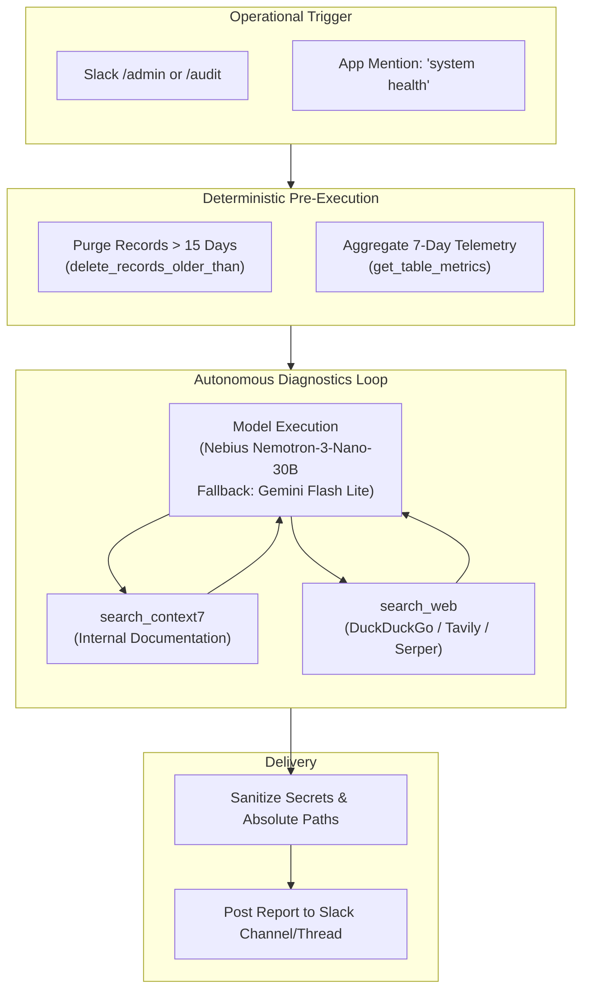

# Administrative & Operations Auditor (Role 4)

The **Administrative & Operations Auditor** (`AdminAgent`) is Aryhant's autonomous system auditor. It performs deterministic data lifecycle hygiene, aggregates operational telemetry, and diagnoses execution failures using integrated documentation search and web tools.



---

## Key Responsibilities

1. **Deterministic Data Retention Pruning**:
   - Executes `SessionTaskService.delete_records_older_than(days=15)` prior to any LLM execution.
   - Ensures stale session task telemetry is purged automatically to comply with privacy requirements and database storage limits.

2. **7-Day Operational Telemetry Aggregation**:
   - Runs `SessionTaskService.get_table_metrics(days=7)` to compute total task volume, status distributions (`completed`, `failed`, `pending`), and failure rates.

3. **Autonomous Failure Diagnostics via `ADMIN_TOOLS`**:
   - If failures exist in the telemetry window, the agent inspects the most recent failed records (`get_failed_tasks(limit=5)`).
   - Utilizes `search_context7` to query internal system documentation and runbooks.
   - Utilizes `search_web` to research external API outages, status codes, or provider anomalies.
   - Evaluates diagnoses through a multi-turn tool calling loop supported by Nebius (`nvidia/NVIDIA-Nemotron-3-Nano-30B-A3B`) with automatic fallback to Gemini (`gemini-flash-lite-latest`).

4. **Sanitized Slack Reporting**:
   - Replaces absolute system paths (e.g. `C:\...` or `/home/...`) with basename tokens.
   - Strips sensitive bearer tokens, API keys, and environment references before posting back to the requesting Slack channel or thread.

---

## Telemetry Storage (`session_tasks`)

Every major autonomous workflow (such as Deep Research) records its lifecycle into the persistent `session_tasks` table managed by `SessionTaskService`:

```sql
CREATE TABLE IF NOT EXISTS session_tasks (
    id TEXT PRIMARY KEY,
    session_id TEXT NOT NULL,
    role TEXT NOT NULL,
    task_type TEXT NOT NULL,
    model_name TEXT,
    status TEXT NOT NULL,
    error TEXT,
    created_at TIMESTAMP DEFAULT CURRENT_TIMESTAMP,
    completed_at TIMESTAMP,
    duration_ms INTEGER
);

CREATE INDEX IF NOT EXISTS idx_session_tasks_session_id ON session_tasks(session_id);
CREATE INDEX IF NOT EXISTS idx_session_tasks_status ON session_tasks(status);
CREATE INDEX IF NOT EXISTS idx_session_tasks_created_at ON session_tasks(created_at);
```

### Task Lifecycle Hooks

Services register and update tasks asynchronously:

```python
from chat_agent.services.session_task_service import SessionTaskService

# 1. Register task start
await session_task_service.acreate_task(
    task_id="res_abc123",
    session_id="slack_thread_987",
    role="researcher",
    task_type="technical_whitepaper",
    model_name="nvidia/NVIDIA-Nemotron-3-Nano-30B-A3B",
    status="running"
)

# 2. Record completion or failure
await session_task_service.acomplete_task(
    task_id="res_abc123",
    status="completed",  # or "failed"
    error=None           # or str(exc)
)
```

---

## Slack Operational Triggers

Operators can invoke administrative audits directly from Slack:

| Trigger | Description | Execution Mode |
| :--- | :--- | :--- |
| `/admin` | Runs data retention pruning, aggregates 7-day telemetry, and produces a diagnostic report. | Async (Instant ACK + Background Delivery) |
| `/audit` | Alias for `/admin` system audit. | Async (Instant ACK + Background Delivery) |
| `@Aryhant system health` | Natural language trigger initiating the auditor workflow. | Threaded reply |

---

## Tool Calling Architecture (`ADMIN_TOOLS`)

The admin agent operates with a dedicated toolset:

- **`search_context7`**: Queries internal system architecture, configuration schemas, and service boundaries.
- **`search_web`**: Queries the live internet for external dependency health, API status pages, and library bugs.

```python
ADMIN_TOOLS = [
    {
        "type": "function",
        "function": {
            "name": "search_context7",
            "description": "Search internal repository documentation, runbooks, and architectural schemas.",
            "parameters": {
                "type": "object",
                "properties": {
                    "query": {"type": "string", "description": "The search query string"}
                },
                "required": ["query"],
            },
        },
    },
    {
        "type": "function",
        "function": {
            "name": "search_web",
            "description": "Perform live internet search across DuckDuckGo, Tavily, or Serper.",
            "parameters": {
                "type": "object",
                "properties": {
                    "query": {"type": "string", "description": "The search query string"}
                },
                "required": ["query"],
            },
        },
    },
]
```
