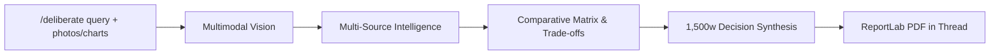

# Deliberation Flow (`/deliberate`)

The `/deliberate` command activates Aryhant's **Dedicated Deliberation Agent**—a parallel research pipeline designed for non-technical, daily life, consumer, and strategic decision-making.

It investigates options across stocks, consumer electronics, skincare and beauty products, insurance policies, healthcare plans, travel itineraries, and lifestyle investments, delivering a **~1,500-word ReportLab PDF Decision Guide** directly into the Slack conversation thread.



---

## Key Features

1. **Target Volume**: ~1,500 words organized across 5 practical decision sections.
2. **Everyday & Strategic Scope**: Built for consumer products, stock comparisons, insurance plans, vehicle purchases, services, and lifestyle decisions.
3. **Comparative Evaluation Matrix**: Synthesizes side-by-side matrices evaluating price, performance, reliability, ease-of-use, and trade-offs.
4. **Google AI Overview**: Ingests Google's AI Overview text blocks and citations via SerpApi (`engine="google_ai_overview"` with `page_token`).
5. **Tavily Mini-Research Polling**: Submits targeted queries to Tavily (`model="mini"`) and polls until completion with session tracking for up-to-date pricing and consumer reviews.
6. **Multimodal Evidence Ingestion**: Ingests user-attached product photos, spec sheets, insurance quotes, nutrition labels, or financial charts and embeds them into the PDF report.
7. **Redis Fault Tolerance**: All job states and task milestones are persisted under `aryhant:job:{job_id}` in Upstash Redis with a 24-hour TTL and in-memory fallback.
8. **Live Slack TODO Board**: Displays dynamic Block Kit progress rows that advance in real time (`⬜` $\to$ `🔄` $\to$ `✅`) via Slack `chat.update`.

---

## Directory Architecture

<Tree>
  <Tree.Folder name="src/chat_agent">
    <Tree.Folder name="tools">
      <Tree.File name="serpapi_tool.py" />
      <Tree.File name="tavily_research_tool.py" />
      <Tree.File name="tool_factory.py" />
    </Tree.Folder>
    <Tree.Folder name="research">
      <Tree.File name="models.py" />
      <Tree.File name="engine.py" />
      <Tree.File name="research_agent.py" />
      <Tree.File name="pdf_builder.py" />
      <Tree.File name="todo_tracker.py" />
    </Tree.Folder>
    <Tree.Folder name="services">
      <Tree.File name="redis_research_store.py" />
    </Tree.Folder>
  </Tree.Folder>
</Tree>

---

## 5-Section Decision Guide Blueprint

Every generated deliberation guide fulfills structured decision quotas:

| Section | Focus | Target Words |
| :--- | :--- | :--- |
| **1. Executive Verdict & Bottom-Line Recommendation** | Clear verdict, primary winner, and bottom-line takeaway | ~250 words |
| **2. Evaluation Criteria & Comparison Matrix Table** | Side-by-side Markdown table comparing options on Price, Quality, Value, and Risk | ~350 words |
| **3. Detailed Contender Breakdown** | Deep dive into top choices with Pros, Cons, and True Costs | ~500 words |
| **4. Hidden Catches, Fine Print & Pitfalls** | Marketing traps, policy fine print, volatility, or ingredients | ~250 words |
| **5. Action Plan & Step-by-Step Buying Guide** | Concrete decision checklist and verified web citations | ~150 words |

---

## Usage in Slack

### Consumer Product Comparison
```text
/deliberate Best noise-canceling headphones under $350 for frequent flyers
```

### Financial / Stock Research
```text
/deliberate NVIDIA vs AMD stock outlook for 2026 AI datacenter acceleration
```

### Insurance / Health Plan Evaluation
```text
/deliberate Term life insurance vs whole life for a 32-year-old with young dependents
```

### Beauty & Skincare
```text
/deliberate Top dermatologist-recommended vitamin C serums for sensitive, acne-prone skin
```

### Mention with Attached Document or Photo
Attach an insurance quote, product spec sheet, or chart and type:
```text
@Aryhant /deliberate Compare these two health insurance policy options and advise on out-of-pocket limits
```

### Live Status Board Progression
When invoked, the bot responds with an initial status message:
```text
🔍 Deliberation In Progress
Topic: Top dermatologist-recommended vitamin C serums for sensitive skin
Scope: Decision Guide (~1,500 words)

✅ 1. Analyze topic, visual context & plan queries
✅ 2. Gather Google AI Overview & Tavily Mini-Research
🔄 3. Construct comparative matrix & evaluate trade-offs
⬜ 4. Synthesize decision guide (~1,500 words)
⬜ 5. Compile ReportLab PDF & upload to Slack
```

Upon completion, the compiled PDF publication is uploaded to the thread and an Executive Summary is posted.
