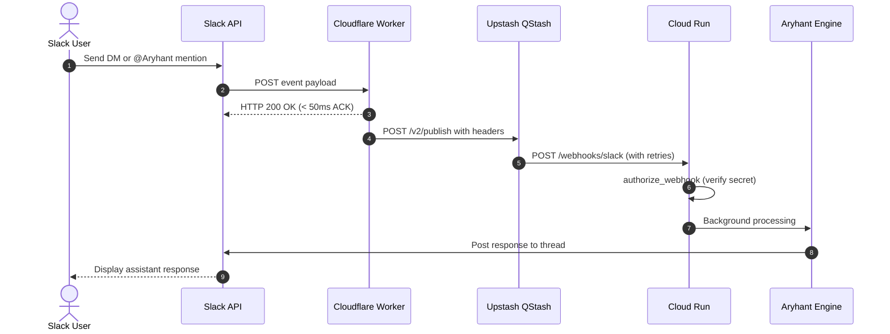

# Cloudflare & QStash Scale-to-Zero Setup

This guide walks through deploying the serverless edge proxy layer using **Cloudflare Workers** and **Upstash QStash** to front Google Cloud Run.

## Why This Architecture?

Google Cloud Run allows scaling down to zero container instances when idle (`--min-instances=0`), keeping hosting costs minimal. However, cold starts can take 5–10 seconds.

Slack's Events API enforces a hard **3-second timeout** for webhook acknowledgments. If Cloud Run is cold-starting, Slack will abort the connection and retry repeatedly, generating duplicate agent executions and chat loops.

To solve this, a lightweight Cloudflare Worker intercepts the event, acknowledges Slack within 50ms, and enqueues the payload into Upstash QStash. QStash buffers the event and retries delivery with exponential backoff until Cloud Run is warm and ready.



---

## Step 1: Upstash QStash Setup

1. Log in to the [Upstash Console](https://console.upstash.com/).
2. Select **QStash** from the top navigation bar.
3. Under the **Details** / **REST API** section, copy the **`QSTASH_TOKEN`**.
4. *(Optional)* Copy `QSTASH_CURRENT_SIGNING_KEY` and `QSTASH_NEXT_SIGNING_KEY` if using QStash receiver signature validation.

---

## Step 2: Generate Shared Secret & Update Cloud Run

Generate a secure 32-byte secret to authenticate webhooks arriving from QStash:

```bash
python -c "import secrets; print(secrets.token_hex(32))"
```

Set this secret on your Cloud Run service via the GCP Console, `gcloud`, or Infisical:

```bash
gcloud run services update aryhant \
  --region=us-central1 \
  --set-env-vars=ARYHANT_WEBHOOK_SHARED_SECRET="<YOUR_GENERATED_SECRET>"
```

In the codebase, `src/chat_agent/webhooks.py` validates incoming requests against this secret using constant-time comparison via `X-Webhook-Secret` or `X-Qstash-Forward-X-Webhook-Secret`.

---

## Step 3: Deploy the Cloudflare Worker

The worker implementation is located in `proxies/cloudflare-slack-ack.js`.

### Option A: Cloudflare Dashboard (GUI)

1. Open the [Cloudflare Dashboard](https://dash.cloudflare.com/) and navigate to **Workers & Pages**.
2. Click **Create Application** $\rightarrow$ **Create Worker**.
3. Name the worker (e.g. `aryhant-slack-proxy`) and click **Deploy**.
4. Click **Edit Code**, delete the default template, paste the contents of `proxies/cloudflare-slack-ack.js`, and click **Deploy**.
5. Go to the worker's **Settings** tab $\rightarrow$ **Variables and Secrets**. Add the following environment variables:

| Variable | Type | Value |
| :--- | :--- | :--- |
| `CLOUD_RUN_WEBHOOK` | Plain Text | `https://<YOUR-CLOUD-RUN-URL>/webhooks/slack` |
| `QSTASH_TOKEN` | Secret / Encrypted | `<QSTASH_TOKEN from Step 1>` |
| `ARYHANT_WEBHOOK_SHARED_SECRET` | Secret / Encrypted | `<Shared secret from Step 2>` |

6. Copy the assigned Worker URL (e.g., `https://aryhant-slack-proxy.<subdomain>.workers.dev`).

### Option B: Wrangler CLI

You can also deploy directly from the repository using Wrangler:

```bash
cd proxies
npx wrangler deploy cloudflare-slack-ack.js --name aryhant-slack-proxy
npx wrangler secret put QSTASH_TOKEN
npx wrangler secret put ARYHANT_WEBHOOK_SHARED_SECRET
npx wrangler secret put CLOUD_RUN_WEBHOOK
```

---

## Step 4: Configure Slack App Console

1. Open your application at [Slack App Console](https://api.slack.com/apps).
2. **Disable Socket Mode** (critical):
   - In the left sidebar, click **Socket Mode**.
   - Toggle **Enable Socket Mode** to **Off**.
   > [!IMPORTANT]
   > If Socket Mode remains enabled, Slack routes all events exclusively over WebSocket and ignores the HTTP Request URL.
3. **Configure Event Subscriptions**:
   - In the left sidebar, click **Event Subscriptions**.
   - Toggle **Enable Events** to **On**.
   - In **Request URL**, enter your Cloudflare Worker URL:
     ```text
     https://aryhant-slack-proxy.<subdomain>.workers.dev
     ```
   - Slack will send an HTTP `url_verification` challenge. `proxies/cloudflare-slack-ack.js` answers automatically and displays a green **Verified** checkmark.
   - Under **Subscribe to bot events**, ensure the following events are added:
     - `app_mention`
     - `message.im`
   - Click **Save Changes** at the bottom of the page.
4. **Reinstall to Workspace**:
   - Navigate to **Install App** in the left sidebar.
   - Click **Reinstall to Workspace** to apply the updated event routing.

---

## Step 5: Verification & End-to-End Testing

1. In Slack, send a direct message or mention `@Aryhant` in a channel where the bot is invited.
2. **Inspect Cloudflare Worker Logs**:
   - In Cloudflare Dashboard $\rightarrow$ **Workers & Pages** $\rightarrow$ `aryhant-slack-proxy` $\rightarrow$ **Logs** $\rightarrow$ **Begin real-time stream**.
   - Confirm messages showing:
     ```text
     Publishing to QStash URL: https://qstash.upstash.io/v2/publish/...
     QStash response: 201 Created
     ```
3. **Inspect Upstash QStash Console**:
   - Open Upstash Console $\rightarrow$ **QStash** $\rightarrow$ **Messages**.
   - Verify the enqueued event has status `Delivered` to your Cloud Run endpoint.
4. **Inspect Cloud Run Logs**:
   - In GCP Cloud Logging or Cloud Run logs, check for:
     ```text
     Webhook authorization successful (shared secret matched).
     Resolved caller for slack:U...: display='...', email='...' (allowed=True)
     ```
   - Verify Aryhant replies directly in the Slack thread.

---

## Troubleshooting Common Issues

| Issue | Root Cause | Solution |
| :--- | :--- | :--- |
| Slack says Request URL verification failed | Worker URL typo or missing `url_verification` handler | Confirm worker is deployed and `payload.type === "url_verification"` returns `payload.challenge`. |
| Slack events never hit Cloudflare Worker | Socket Mode is still toggled On | Go to **Socket Mode** in Slack Console and toggle to **Off**. Reinstall the app. |
| QStash returns 401 Unauthorized | Invalid or expired `QSTASH_TOKEN` in Cloudflare Worker | Verify `QSTASH_TOKEN` in Worker Variables & Secrets matches Upstash Console. |
| Cloud Run returns 401 Unauthorized | Missing or mismatched `ARYHANT_WEBHOOK_SHARED_SECRET` | Ensure `ARYHANT_WEBHOOK_SHARED_SECRET` on Cloud Run matches `ARYHANT_WEBHOOK_SHARED_SECRET` in Cloudflare Worker. |
| Cloud Run returns 503 Service Unavailable | Neither `ARYHANT_WEBHOOK_SHARED_SECRET` nor `SLACK_SIGNING_SECRET` set | Configure `ARYHANT_WEBHOOK_SHARED_SECRET` in Cloud Run environment variables. |
