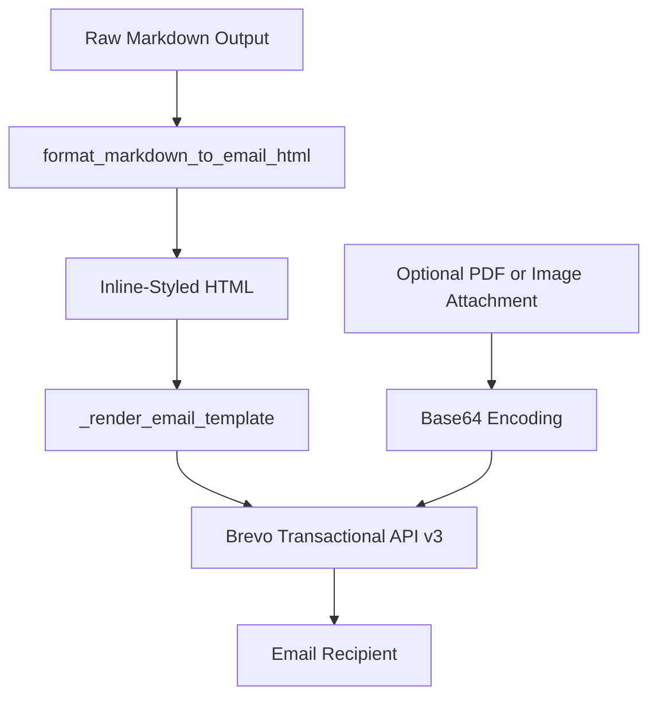
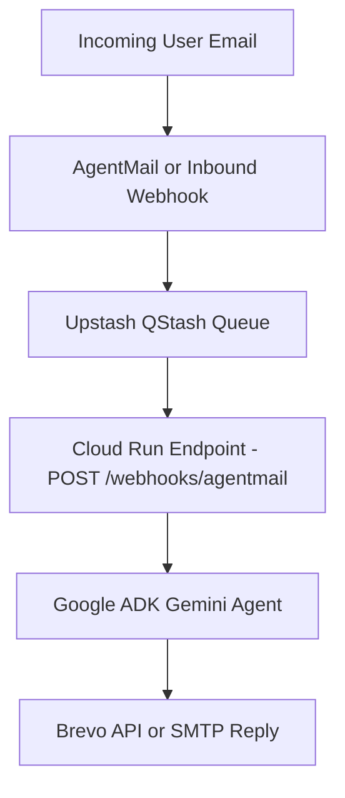

# Email channel

The agent provides email capabilities across two primary dimensions: **Brevo transactional email templating** (implemented in `src/chat_agent/config/email_message_helper.py`) and **IMAP/SMTP messaging configuration** in `src/chat_agent/config/settings.py`.

## 1. Brevo Transactional Email Helper

`src/chat_agent/config/email_message_helper.py` formats and dispatches responsive, template-driven transactional emails via the Brevo (formerly Sendinblue) SMTP API (`https://api.brevo.com/v3/smtp/email`).

### Key Functions

#### `format_markdown_to_email_html(md_text, timestamp, model_usage)`
Converts markdown into email-safe HTML with inline CSS styling for universal email client compatibility (supporting Outlook, Gmail, Apple Mail):
- Tables styled with border collapse, distinct headers (`#eff6ff`), and alternating cell borders.
- Blockquotes styled with blue accent borders (`#3b82f6`) and light background fills.
- Code blocks (`<pre><code>`) styled with dark syntax themes (`#0f172a`).
- Appends optional execution model usage metrics and completion timestamps.

#### `send_email_with_brevo_template(...)`
Dispatches a template-backed transactional email:
- Accepts `to_emails`, `cc_emails`, `subject_text`, and `content`.
- Auto-serializes Pydantic models via `model_dump()`.
- Supports optional attachments from presigned URLs.

#### `send_email_with_brevo_and_pdf_attachment(...)`
Dispatches transactional emails with attached local PDF documents or files downloaded via presigned URLs:
- Reads local PDF files from `pdf_path`, encodes to base64, and attaches to the Brevo payload.
- Injects template parameters and unescaped HTML content.

## 2. IMAP & SMTP Configuration

Application settings for email connectivity are configured via environment variables in `src/chat_agent/config/settings.py`:

| Variable | Default | Purpose |
| :--- | :--- | :--- |
| `EMAIL_ENABLED` | `false` | Master toggle for email features |
| `BREVO_API_KEY` | `""` | API key for Brevo transactional email dispatch |
| `EMAIL_ADDRESS` | `""` | IMAP/SMTP account username / email address |
| `EMAIL_PASSWORD` | `""` | IMAP/SMTP app password |
| `EMAIL_IMAP_HOST` | `imap.gmail.com` | IMAP host address |
| `EMAIL_IMAP_PORT` | `993` | IMAP SSL port |
| `EMAIL_SMTP_HOST` | `smtp.gmail.com` | SMTP host address |
| `EMAIL_SMTP_PORT` | `587` | SMTP STARTTLS port |
| `EMAIL_ALLOWED_SENDERS` | `""` | Comma-separated allowlist of permitted senders |
| `EMAIL_POLL_SECONDS` | `60` | Polling interval in seconds |
| `EMAIL_MAX_BODY_CHARS` | `4000` | Input character truncation limit for email bodies |

The property `settings.email_ready` evaluates to `true` when `EMAIL_ENABLED`, `EMAIL_ADDRESS`, and `EMAIL_PASSWORD` are all populated.

## 3. Scale-to-Zero Event-Driven Email (Planned)

In a scale-to-zero Cloud Run environment, persistent IMAP background polling loops are unviable. The planned event-driven email architecture uses inbound webhooks:

1. **Inbound Webhook**: An inbound email service (e.g. AgentMail) triggers a webhook on receiving an email.
2. **QStash Enqueueing**: The webhook publishes to QStash, which retries delivery until Cloud Run scales up.
3. **Verified Execution**: Cloud Run verifies the request signature via `verify_qstash`, runs the ADK agent, and sends the reply using the Brevo transactional helper.
