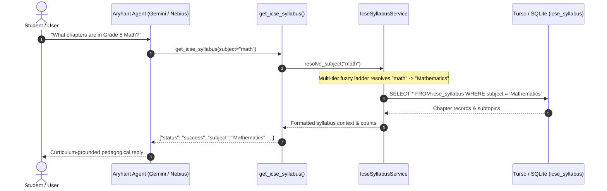

# ICSE syllabus

The ICSE Syllabus service provides structured, curriculum-aligned pedagogical grounding for Aryhant. It stores and queries Grade 5 chapters and subtopics across six core ICSE subjects, ensuring that practice questions, study notes, and explanations adhere strictly to the syllabus.

The system is backed by **Turso (libSQL)** in production and seamlessly falls back to local SQLite (`aryhant.db`) for offline development and hermetic testing.

---

## Supported Subjects

The database models chapters and subtopics for the six primary ICSE Grade 5 disciplines:

| Subject | Scope & Chapter Highlights | Typical Chapters |
| :--- | :--- | :--- |
| **Mathematics** | Numbers, Operations, Fractions, Decimals, Measurement, Geometry | Large Numbers, Operations on Numbers, Fractions, Decimals, Perimeter & Area |
| **Science** | Living World, Human Body, Matter, Energy, Environment | Plant Reproduction, Human Body: Circulatory & Nervous Systems, Solids, Liquids, Gases |
| **Social Studies** | History, Civics, Physical & Political Geography | Major Landforms, Climatic Zones, Democratic Government, Environmental Conservation |
| **English** | Grammar, Composition, Comprehension, Vocabulary | Parts of Speech, Tenses, Subject-Verb Agreement, Formal Letters, Essay Writing |
| **Hindi** | Vyakaran (Grammar), Sahitya (Literature), Bhasha Gyaan | Sangya, Sarvanaam, Kriya, Visheshan, Varn Vichar, Kahani Lekhan |
| **Computer Studies**| Computing Fundamentals, OS, Word Processing, Scratch Coding | History of Computers, Files and Folders, MS Word Formatting, Scratch Programming |

---

## Architecture & Data Flow

When a student or teacher asks for syllabus guidance, practice problems, or notes, the agent dispatches `get_icse_syllabus`:



---

## Database Schema

The table `icse_syllabus` is automatically provisioned via idempotent migration:

```sql
CREATE TABLE IF NOT EXISTS icse_syllabus (
    id INTEGER PRIMARY KEY AUTOINCREMENT,
    subject TEXT NOT NULL,
    term TEXT NOT NULL DEFAULT 'full_year',
    chapter TEXT NOT NULL,
    subtopics TEXT,
    created_at INTEGER NOT NULL,
    updated_at INTEGER NOT NULL,
    UNIQUE(subject, term, chapter)
);

CREATE INDEX IF NOT EXISTS idx_icse_syllabus_subject ON icse_syllabus(subject, term);
```

- **`UNIQUE(subject, term, chapter)`**: Ensures idempotent upserts via `INSERT ... ON CONFLICT(subject, term, chapter) DO UPDATE`.
- **`idx_icse_syllabus_subject`**: Optimizes fast filtered chapter queries by subject and academic term.

---

## Resilient Fuzzy Subject Resolution

Students and models rarely supply exact canonical subject names. The `resolve_subject(query)` method implements a 4-tier resolution ladder:

1. **Exact Match (Case-Insensitive)**: `"mathematics"` &rarr; `"Mathematics"`
2. **Substring Containment**: `"math"` &rarr; `"Mathematics"`, `"computer"` &rarr; `"Computer Studies"`
3. **Word-Overlap Matching**: `"general science"` shares `"science"` &rarr; `"Science"`, `"social science"` shares `"social"` &rarr; `"Social Studies"`
4. **Typo Tolerance (`difflib`)**: Uses Levenshtein-like sequence matching with a `0.6` cutoff:
   - `"matematics"` &rarr; `"Mathematics"`
   - `"computr"` &rarr; `"Computer Studies"`

If no candidate matches, the service gracefully returns an empty string, prompting the tool to list all available subjects instead of failing.

---

## Python API & Agent Tool

### Service Interface

Exported from `src/chat_agent/services/icse_syllabus_service.py`:

```python
from chat_agent.services.icse_syllabus_service import IcseSyllabusService

svc = IcseSyllabusService()

# 1. Query available subjects
subjects = svc.list_syllabus_subjects()

# 2. Fuzzy resolve subject name
canonical_name = svc.resolve_subject("math")  # "Mathematics"

# 3. Retrieve chapters and subtopics
chapters = svc.get_syllabus("Mathematics")

# 4. Generate prompt-injectable context block
context = svc.get_syllabus_context("Science")
```

### Tool Function

Exported from `src/chat_agent/tools/tool_factory.py` and bound to all model runners:

```python
def get_icse_syllabus(subject: str = "") -> dict:
    """
    Fetch the stored ICSE Grade 5 syllabus for one of the six subjects — Mathematics,
    English, Hindi, Science, Social Studies, or Computer Studies. Pass a subject to get its
    chapters and subtopics; omit it to list all subjects.
    """
```

#### Sample Tool Response

```json
{
  "status": "success",
  "subject": "Mathematics",
  "requested": "math",
  "chapter_count": 8,
  "syllabus": "ICSE Grade 5 Mathematics syllabus:\n- Large Numbers: Indian & International systems, Place Value\n- Operations on Numbers: Multi-digit multiplication, division with remainder\n- Fractions: Equivalent fractions, addition, subtraction\n- Decimals: Tenths, hundredths, operations"
}
```

---

## Model Runner Integration

The tool is bound across all agent channels:

- **Google Gemini SDK** (`src/chat_agent/agents/gemini_model_runner.py`): Registered in `_TOOLS` list for dynamic function calling.
- **Nebius & OpenAI Runner** (`src/chat_agent/agents/nebius_model_runner.py`): Configured in `OPENAI_TOOLS` schema with function name `get_icse_syllabus`.
- **System Instructions** (`src/chat_agent/agents/prompt.py`): Persona prompt explicitly instructs Aryhant to inspect the syllabus before providing tutoring, generating quizzes, or drafting study notes.
