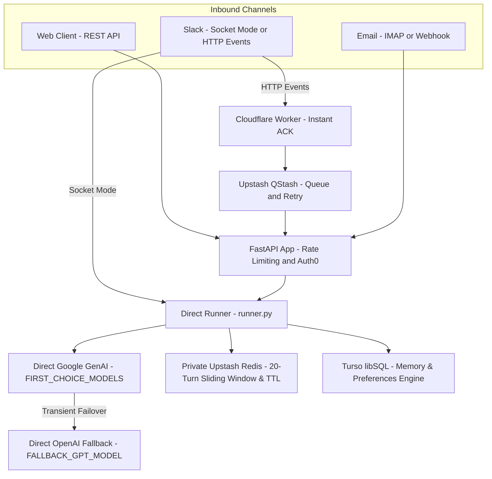
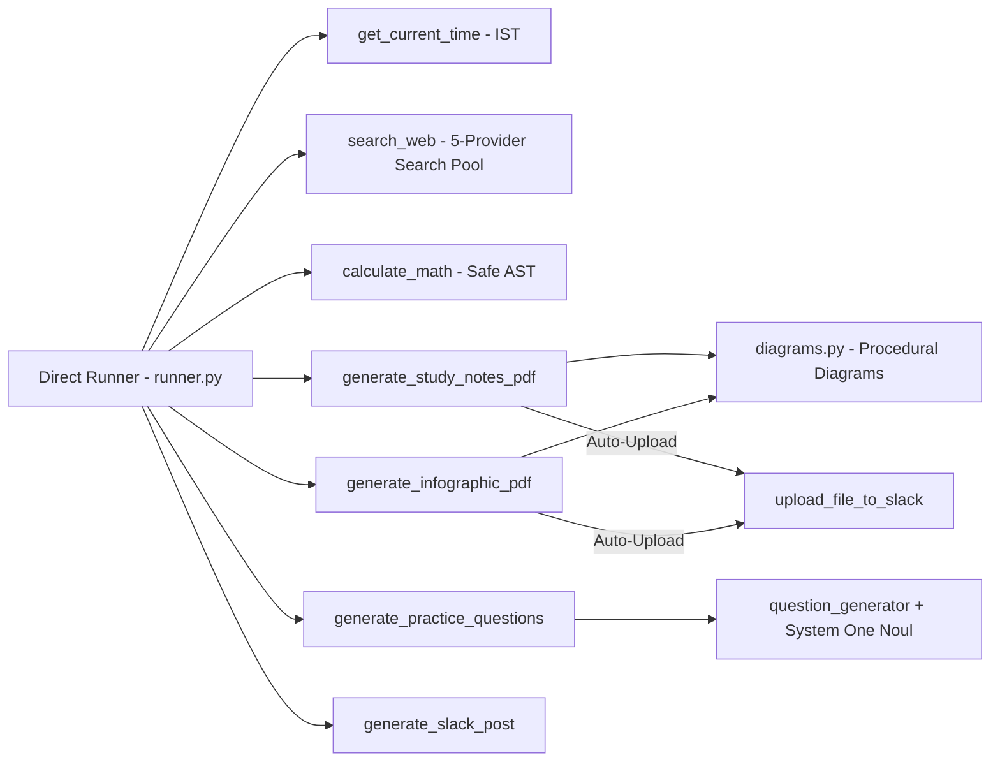

# Overview

A multimodal daily AI companion and educational assistant that serves chat input from Slack, email, and REST API channels using direct Google GenAI and OpenAI models. Aryhant provides broad, practical daily assistance (answering inquiries, planning, writing, problem-solving, and coding) while specializing as an expert AI teaching companion for Grade 5 students of St. Xavier's following the ICSE curriculum.

## System Architecture

The request path and the model execution core:

The tools the runner dispatches to, and the background PDF pipeline:

## Key Capabilities

- **Versatile Daily AI Companion**: Provides thoughtful assistance across everyday inquiries, personal organization, writing, explanations, research, and general problem-solving, with technical/coding help available when requested.
- **St. Xavier's ICSE Grade 5 Persona**: Calibrates academic guidance to ICSE standards, enforces plain-text math (`3/5`, `cm²`, `+`, `-`, `x`, `÷`, zero raw LaTeX), generates 5–10 numbered practice questions, and groups answer keys at the end.
- **Question Generation & TypeSafe Curation**: A provider-selectable generator package (`question_generator/`) generates 15–20 candidate practice questions and hints, and the `generate_practice_questions(topic)` tool runs the full pipeline: candidates generation, then TypeSafe AI System One (`Noul`) parallel hint scoring and top-10 curation.
- **Universal Visual Notes on Any Topic**: Compiles handwritten notebook-style PDFs (`generate_study_notes_pdf`) and visual posters (`generate_infographic_pdf`) on any subject (school lessons, technical guides, recipes, general learning) on background threads and auto-uploads them to Slack without delaying the text reply.
- **Direct Multi-Model Engine with Failover**: Executes up to 3 randomized attempts across `FIRST_CHOICE_MODELS` via direct `google.genai.Client` with transient backoff, seamlessly falling back to `FALLBACK_GPT_MODEL` (`gpt-6-luna`) via `AsyncOpenAI` or native REST completions.
- **Safe Math Evaluation Tool**: The `calculate_math(expression)` tool evaluates arithmetic, LCM, GCD/HCF, powers, roots, and multi-step expressions through Python's `ast` module with no `eval`, applying operator/function allowlists and exponent bounds.
- **Procedural Math & Science Diagrams**: Generates crisp vector curves, geometric shapes, electrical circuits, and biological illustrations with pure ReportLab drawing primitives.
- **Dual-Mode Slack Architecture**: Supports local development via native Slack Bolt Socket Mode (`AsyncSocketModeHandler`) and production scale-to-zero on Google Cloud Run via a Cloudflare Worker proxy and Upstash QStash retry queue.
- **Rich Slack Block Kit Formatting**: Converts raw markdown into Slack Block Kit structures (`header`, `divider`, `section`, `context`) while enforcing Slack's 20-block ceiling (`MAX_BLOCKS = 20`) and 3000-character section limit.
- **Multimodal Attachment Pipeline**: Ingests images, audio, PDFs, CSVs, and plain text files with per-file (500 KB) and cumulative (2 MB) size budgeting, authenticated Slack CDN downloads, and prior-turn binary history pruning.
- **Multi-Provider Web Search Pool**: Features weighted random selection and automatic failover across DuckDuckGo, Exa, Firecrawl, Tavily, and Serper with GPT summarization for contexts exceeding 10,000 characters.
- **Private Redis Session Store**: Persists multi-turn conversation thread histories in private Upstash Redis with a strict 20-turn sliding window (`LTRIM`) and 24-hour TTL (`REDIS_TTL_SEC`), with seamless in-memory fallback.
- **Turso Personal Memory & Preferences Engine**: Stores structured, PII-free student preferences, habits, and learned skills with multi-script tokenization (English, Hindi, Bengali), keyword overlap reinforcement, and automatic promotion to `'skill'` at `weight >= 3`.
- **Interactive Slack Preferences Modal (`/preferences`)**: Provides student data sovereignty via a private Block Kit popup modal with real-time deletion and clear-all actions.
- **Deterministic Email Access Control (`ARYHANT_ALLOWED_EMAILS`)**: Enforces workspace user authorization via `client.users_info` email resolution. Unauthorized callers receive an immediate, deterministic polite denial, bypassing LLM runner execution and protecting quota.
- **Direct Turso libSQL Memory Service**: Direct connection to remote Turso databases (`ARYHANT_TURSO_DATABASE_URL`), storing learning preferences and student emails across turns without local replica synchronization.
- **Strict Redis Key Isolation**: Thread session keys strictly prefixed with `aryhant:` (`format_session_key`) for multi-tenant Upstash Redis isolation.

## Codebase Structure

<Tree>
  <Tree.Folder name="docs" defaultOpen>
    <Tree.File name="docs.json" highlight />
    <Tree.File name="custom.css" />
    <Tree.File name="index.mdx" highlight />
  </Tree.Folder>
  <Tree.Folder name="scripts" defaultOpen>
    <Tree.File name="init_turso_db.py" highlight />
  </Tree.Folder>
  <Tree.Folder name="proxies" defaultOpen>
    <Tree.File name="cloudflare-slack-ack.js" highlight />
  </Tree.Folder>
  <Tree.Folder name="src" defaultOpen>
    <Tree.Folder name="chat_agent" defaultOpen>
      <Tree.File name="app.py" highlight />
      <Tree.File name="main.py" highlight />
      <Tree.File name="webhooks.py" />
      <Tree.Folder name="agents" defaultOpen>
        <Tree.File name="gemini_model_runner.py" highlight />
        <Tree.File name="model_runner.py" highlight />
        <Tree.File name="nebius_model_runner.py" highlight />
        <Tree.File name="prompt.py" highlight />
        <Tree.File name="question_generator.py" highlight />
        <Tree.File name="runner.py" highlight />
      </Tree.Folder>
      <Tree.Folder name="question_generator" defaultOpen>
        <Tree.File name="__init__.py" />
        <Tree.File name="base_question_generator.py" highlight />
        <Tree.File name="gemini_question_generator.py" highlight />
        <Tree.File name="nebius_question_generator.py" highlight />
      </Tree.Folder>
      <Tree.Folder name="config" defaultOpen>
        <Tree.File name="settings.py" highlight />
        <Tree.File name="auth0_config.py" />
        <Tree.File name="email_message_helper.py" />
        <Tree.File name="grafana_config.py" />
        <Tree.File name="logging_config.py" />
        <Tree.File name="qstash_authentication.py" />
        <Tree.File name="rate_limiter.py" />
      </Tree.Folder>
      <Tree.Folder name="infographics" defaultOpen>
        <Tree.File name="notes_builder.py" highlight />
        <Tree.File name="builder.py" highlight />
        <Tree.File name="diagrams.py" highlight />
        <Tree.File name="canvas.py" />
        <Tree.File name="config.py" />
        <Tree.File name="theme.py" />
        <Tree.File name="branding.json" />
      </Tree.Folder>
      <Tree.Folder name="schema" defaultOpen>
        <Tree.File name="fundamental_schema.py" highlight />
      </Tree.Folder>
      <Tree.Folder name="services" defaultOpen>
        <Tree.File name="__init__.py" />
        <Tree.File name="redis_session_store.py" highlight />
        <Tree.File name="turso_memory_service.py" highlight />
      </Tree.Folder>
      <Tree.Folder name="slack" defaultOpen>
        <Tree.File name="post_generator.py" highlight />
        <Tree.File name="slack_app.py" highlight />
        <Tree.File name="preferences_modal.py" highlight />
        <Tree.File name="slack_http.py" highlight />
      </Tree.Folder>
      <Tree.Folder name="tools" defaultOpen>
        <Tree.File name="duckduckgo_search.py" highlight />
        <Tree.File name="math_tool.py" highlight />
        <Tree.File name="tool_factory.py" highlight />
      </Tree.Folder>
      <Tree.Folder name="utils" defaultOpen>
        <Tree.Folder name="fast_decision" defaultOpen>
          <Tree.File name="typesafe_integrator.py" highlight />
        </Tree.Folder>
        <Tree.File name="input_validation.py" highlight />
        <Tree.File name="math_formatter.py" highlight />
        <Tree.File name="text_formatter.py" highlight />
        <Tree.File name="multimodal.py" highlight />
        <Tree.File name="openai_utility.py" />
        <Tree.File name="path_utils.py" />
      </Tree.Folder>
    </Tree.Folder>
  </Tree.Folder>
  <Tree.Folder name="tests" defaultOpen>
    <Tree.File name="conftest.py" />
    <Tree.File name="test_agent.py" />
    <Tree.File name="test_app.py" />
    <Tree.File name="test_config.py" />
    <Tree.File name="test_email.py" />
    <Tree.File name="test_multimodal.py" />
    <Tree.File name="test_notes_generator.py" highlight />
    <Tree.File name="test_qstash.py" />
    <Tree.File name="test_question_generator.py" highlight />
    <Tree.File name="test_slack.py" />
    <Tree.File name="test_duckduckgo_search.py" highlight />
    <Tree.File name="test_tools.py" />
    <Tree.File name="test_typesafe_feedback.py" highlight />
    <Tree.File name="test_validation.py" />
  </Tree.Folder>
  <Tree.File name="CLAUDE.md" />
  <Tree.File name="Dockerfile" />
  <Tree.File name="pyproject.toml" />
  <Tree.File name="README.md" />
  <Tree.File name="requirements.txt" />
</Tree>

## Module Navigation

- [Prerequisites](/prerequisites): Model keys, Slack OAuth scopes, event subscriptions, and token verification.
- [Slack Channel](/slack): Socket Mode vs HTTP Events API, Cloudflare Worker forwarding, Block Kit post formatting, and PDF file uploads.
- [Question Generation & TypeSafe Curation](/question-generation): Provider-selectable generator package, `QuestionAnswerSchema`, the `generate_practice_questions` tool, and TypeSafe System One hint scoring.
- [Safe Math Tool](/math-tool): The `calculate_math` AST evaluator, supported operators/functions, and safety bounds.
- [Study Notes & Infographics](/study-notes): ReportLab notebook notes, visual lesson posters, procedural diagrams, and auto-upload delivery.
- [Email Channel](/email): Brevo template rendering, PDF attachments, IMAP/SMTP configuration, and planned AgentMail path.
- [Multimodal Handling](/multimodal): File extraction, CDN downloads, moderation layers, and in-memory binary pruning.
- [API & Auth](/api-reference): FastAPI endpoints (`/`, `/api/health`, `/api/chat`, `/webhooks/slack`), rate limits, and Auth0 security.
- [Web Search](/web-search): 5-provider search tool pool, weighted selection, fallback mechanics, and GPT summarization.
- [Nebius Token Factory](/nebius): Multimodal vision capabilities, Nemotron 3.5 Super VL, and interactive function calling.
- [Observability](/observability): Structured logging, rate limiting, Auth0 JWT verification, QStash authentication, and Grafana Cloud OpenTelemetry.
- [Operations & Deployment](/operations): Complete environment variable reference, Docker containerization, Cloud Run deployment, and CLI commands.
- [FAQ & Troubleshooting](/faq): Step-by-step diagnostic triage ladder and solutions to common configuration traps.

