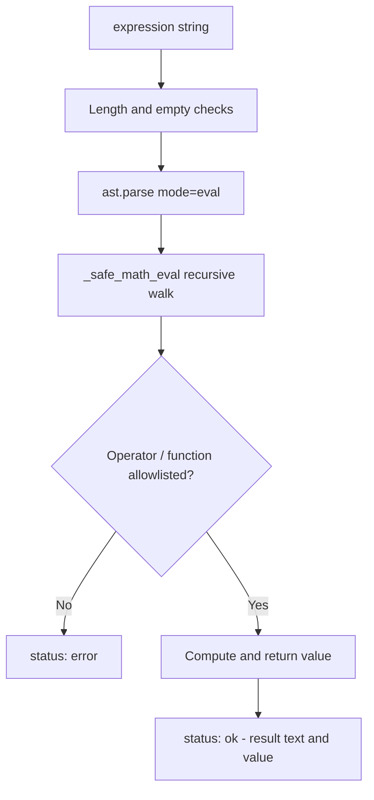

# Safe math tool

Aryhant exposes a `calculate_math(expression)` tool so the agent computes exact arithmetic instead of estimating. It lives in `src/chat_agent/tools/math_tool.py` and is bound alongside the other tools in both direct runners (`gemini_model_runner.py` and `nebius_model_runner.py`). The system prompt instructs the model to call it for exact arithmetic, LCM, GCD/HCF, powers, and multi-step calculations.

## How it works

The tool parses the expression with Python's `ast` module (`ast.parse(expr, mode="eval")`) and walks the tree itself — it never calls `eval`. Only allowlisted node types, operators, and functions are evaluated, and each result is returned as a small dict.



## Supported syntax

| Category | Allowed |
| :--- | :--- |
| Binary operators | `+`, `-`, `*`, `/`, `//`, `%`, `**` |
| Unary operators | `+x`, `-x` |
| Functions | `abs`, `round`, `min`, `max`, `sum`, `pow`, `sqrt`, `isqrt`, `gcd`, `lcm`, `factorial`, `floor`, `ceil` |
| Constants | integers, floats, complex |

Function names are case-insensitive. Only simple `Name` calls are accepted (no attribute or method calls).

## Safety bounds

- **No `eval`**: Evaluation is a hand-written recursion over the allowlisted AST nodes; unknown nodes raise and are reported as errors.
- **Expression length cap**: Expressions longer than 1000 characters are rejected.
- **Exponent bounds**: For `**`, the exponent must satisfy `abs(right) <= 500` and `abs(left) <= 10000`.
- **Constant types**: Only `int`, `float`, and `complex` constants are permitted.
- **Division by zero**: Returned as a friendly message (`Division by zero is not defined...`) rather than an exception.

## Return contract

```python
from chat_agent.tools.math_tool import calculate_math

calculate_math("(15 * 4) + 12")
# {"status": "ok", "result": "The result is 72", "value": 72}

calculate_math("lcm(12, 18)")
# {"status": "ok", "result": "The result is 36", "value": 36}

calculate_math("")
# {"status": "error", "message": "expression is required"}
```

| Field | Present when | Meaning |
| :--- | :--- | :--- |
| `status` | always | `"ok"` or `"error"` |
| `result` | `status == "ok"` | Human-readable `The result is ...` sentence |
| `value` | `status == "ok"` | The raw computed value |
| `message` | `status == "error"` | Reason the expression was rejected |

## Source layout

<Tree>
  <Tree.Folder name="src" defaultOpen>
    <Tree.Folder name="chat_agent" defaultOpen>
      <Tree.Folder name="tools" defaultOpen>
        <Tree.File name="math_tool.py" highlight />
        <Tree.File name="tool_factory.py" />
      </Tree.Folder>
      <Tree.Folder name="agents" defaultOpen>
        <Tree.File name="gemini_model_runner.py" highlight />
        <Tree.File name="nebius_model_runner.py" highlight />
        <Tree.File name="prompt.py" />
      </Tree.Folder>
    </Tree.Folder>
  </Tree.Folder>
</Tree>
