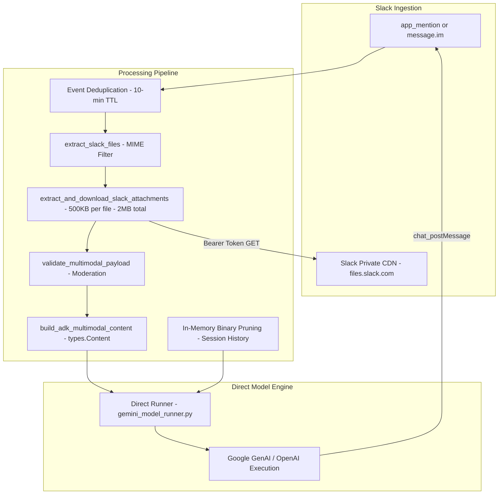
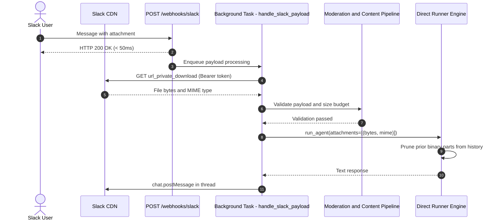

# Multimodal Handling

The agent processes **Text**, **Image**, **Audio**, and **Document** attachments received from Slack (`@mentions` in channels and direct messages). Attachments are fetched from Slack's authenticated CDN, validated against size budgets and moderation filters, assembled into `google.genai.types.Content`, and executed inside the conversation thread's session.

## Architecture

### End-to-End Multimodal Sequence

## Pipeline Stages

### 1. File Extraction (`extract_slack_files`)

Located in `src/chat_agent/utils/multimodal.py`:
- Reads `event["files"]` and extracts `url_private_download` (or `url_private`).
- Filters files against `SUPPORTED_MIME_PREFIXES`: `image/`, `audio/`, `application/pdf`, `text/csv`, `text/plain`, `text/markdown`, `text/html`, `application/json`.
- Enforces `MAX_ATTACHMENTS_PER_MESSAGE = 5` valid attachments per message.

### 2. Authenticated Download & Size Budgets (`download_slack_file`)

- Downloads content via `httpx.AsyncClient` with `Authorization: Bearer <ARYHANT_SLACK_BOT_TOKEN>`.
- **Per-File Budget**: Enforces `MAX_SINGLE_ATTACHMENT_SIZE_KB = 500` (500 KB). Oversized files raise a `ValueError` and are skipped.
- **Cumulative Budget**: Enforces `MAX_CUMULATIVE_ATTACHMENT_SIZE_MB = 2` (2 MB total). Remaining files are skipped once the cumulative budget is exhausted.
- **CDN Auth Guard**: Detects if Slack returned an HTML login page (`text/html`) instead of the requested binary file and rejects invalid downloads.

### 3. Moderation Pipeline (`validate_multimodal_payload`)

Content safety is enforced through configurable layers:

1. **Gemini Native Moderation Fast Path** (Default):
   - When `IS_GEMINI_MODERATION_ENOUGH=true`, external moderation APIs are bypassed.
   - Relies on Gemini's built-in `types.SafetySetting` configured in `gemini_model_runner.py` (blocking medium/high harm for hate speech, harassment, dangerous content, and sexual content), minimizing latency and external API costs.
2. **External Moderation Pipeline** (When `IS_GEMINI_MODERATION_ENOUGH=false`):
   - **Regex Scan**: Evaluates prompts against compiled patterns for shell injection, SQL injection, docker abuse, and system commands in `src/chat_agent/utils/input_validation.py`.
   - **Groq Prompt Guard**: Calls `meta-llama/llama-prompt-guard-2-22m` when `GROQ_API_KEY` is provided.
   - **OpenAI Omni-Moderation**: Calls `omni-moderation-latest` on images (via data URLs) and audio files (`mp3` / `wav` formats).

### 4. Content Assembly (`build_adk_multimodal_content`)

Constructs a `google.genai.types.Content` object:
- Text prompt (truncated to `MAX_INPUT_CHARS = 4000`) is added via `types.Part.from_text(text=prompt)`.
- Attachment binaries are appended via `types.Part.from_bytes(data=data, mime_type=mimetype)`.

### 5. Prior-Turn Binary Pruning

To prevent image/audio tokens from bloating context windows across multi-turn conversations, media is sanitized after processing:

- **Session History Pruning** (`_prune_prior_binary_parts` in `src/chat_agent/agents/gemini_model_runner.py`):
  - Walks the stored session history in `_HISTORY[session_id]`.
  - Replaces all binary `inline_data` parts with `[Attachment: <mime> - processed in prior turn]`.

## Configuration & Limits

| Setting | Default | Description |
| :--- | :--- | :--- |
| `MULTIMODAL_ENABLED` | `true` | Enables Slack attachment downloading and processing |
| `IS_GEMINI_MODERATION_ENOUGH` | `true` | Uses Gemini native safety settings and skips external moderation APIs |
| `MAX_ATTACHMENTS_PER_MESSAGE` | `5` | Maximum number of attachments parsed per message |
| `MAX_SINGLE_ATTACHMENT_SIZE_KB` | `500` | Maximum allowed file size per attachment in KB |
| `MAX_CUMULATIVE_ATTACHMENT_SIZE_MB` | `2` | Maximum cumulative attachment size per message in MB |
| `MAX_INPUT_CHARS` | `4000` | Character limit for input text prompts |