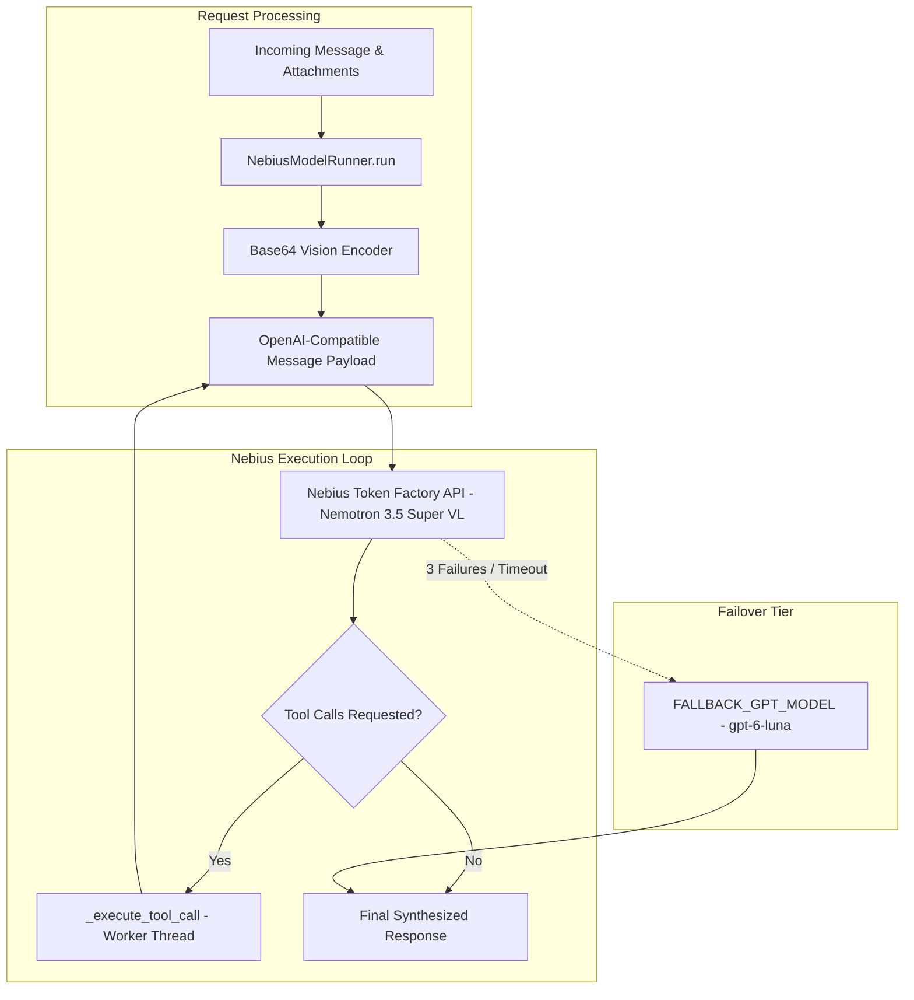

# Nebius Token Factory & Nemotron Vision

Aryhant supports **Nebius Token Factory** as an alternative model execution runner implementing the unified `ModelRunner` interface. Inference runs against **NVIDIA Nemotron 3.5 Super VL** (`nvidia/Nemotron-3.5-Super-VL`), an open 120B parameter Mixture-of-Experts (MoE) vision-language model optimized for agentic reasoning and visual comprehension.

## Runner Architecture

The `NebiusModelRunner` provides full feature parity with the primary Gemini engine, including base64 visual parsing, multi-turn tool calling, session history persistence, and failover mechanics.



## Multimodal Vision Input

Nebius vision models ingest images through standard OpenAI `image_url` data structures. Incoming image attachments from Slack are converted into base64 data URLs:

```json
{
  "type": "image_url",
  "image_url": {
    "url": "data:image/png;base64,iVBORw0KGgoAAAANSUhEUgAA..."
  }
}
```

### Supported Attachment Types
- **Homework and Worksheets**: Photos captured by students or teachers (`image/png`, `image/jpeg`, `image/webp`).
- **Mathematical Curves and Diagrams**: High-resolution vector and raster charts.
- **Scanned Text**: Reading passages, science diagrams, and exam papers.

To preserve token budgets and prevent memory growth across multi-turn conversations, prior-turn base64 data URLs are automatically converted into lightweight text placeholders (`[Attached Image - processed in prior turn]`) in session history.

## Function Calling & Tool Support

`NebiusModelRunner` binds six core application tools via standard OpenAI function definitions:

1. **`get_current_time`**: Returns current timestamps in Indian Standard Time (IST) and UTC.
2. **`search_web`**: Multi-provider real-time search across DuckDuckGo, Tavily, Exa, Firecrawl, and Serper.
3. **`generate_study_notes_pdf`**: Compiles handwritten notebook-style ReportLab PDFs and auto-uploads them to Slack.
4. **`generate_infographic_pdf`**: Compiles visual lesson infographic posters and auto-uploads them to Slack.
5. **`generate_practice_questions`**: Generates ICSE Grade 5 practice questions and hints for a topic.
6. **`calculate_math`**: Safely evaluates a math expression via AST parsing (no `eval`).

When Nemotron requests tool execution, the runner executes the function on a worker thread (`asyncio.to_thread`), formats the result as a `role: "tool"` message, and resubmits the context (up to 5 rounds) until generation completes.

## Configuration & Activation

To switch the active model runner to Nebius, update your environment variables:

```bash
# Model Provider Switch
MODEL_PROVIDER=nebius

# Nebius Token Factory Credentials
NEBIUS_API_KEY=your_nebius_api_key_here
NEBIUS_BASE_URL=https://api.tokenfactory.nebius.com/v1
NEBIUS_MODEL=nvidia/Nemotron-3.5-Super-VL
```

### Configuration Parameters

| Variable | Default | Description |
| :--- | :--- | :--- |
| `MODEL_PROVIDER` | `"nebius"` | Active engine selector: `"gemini"` or `"nebius"`. |
| `NEBIUS_API_KEY` | `""` | Nebius Token Factory API key. |
| `NEBIUS_BASE_URL` | `"https://api.tokenfactory.nebius.com/v1"` | Nebius OpenAI-compatible endpoint base URL. |
| `NEBIUS_MODEL` | `"nvidia/Nemotron-3.5-Super-VL"` | Target vision-language model identifier. |
| `MAX_OUTPUT_TOKENS` | `8000` | Maximum output generation token budget. |

## Resilience & Retry Strategy

- **Transient Error Detection**: Automatically intercepts rate limits (`429`), server unavailability (`503`), and connection timeouts.
- **Exponential Backoff**: Applies randomized jittered backoff (`base=0.8s`, `cap=3.0s`) across 3 primary attempts.
- **Graceful Fallback**: If all attempts fail or the endpoint is unreachable, execution falls back seamlessly to `FALLBACK_GPT_MODEL` (`gpt-6-luna`).
