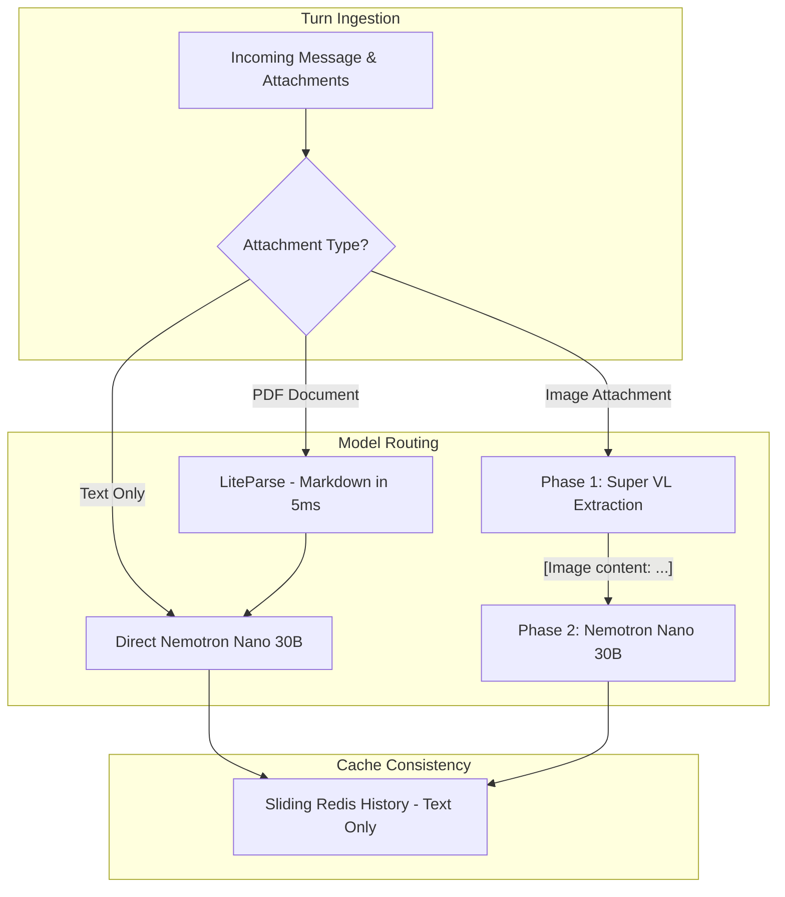

# Nebius Token Factory & Nemotron Architecture

Aryhant supports **Nebius Token Factory** (`api.tokenfactory.nebius.com/v1`) as its primary model execution engine implementing the unified `ModelRunner` interface. The engine couples **NVIDIA Nemotron 3 Nano 30B** for fast conversational inference with **NVIDIA Nemotron 3.5 Super VL** for multimodal extraction and LiteParse for direct PDF text extraction.

## Nano/VL Routing & Two-Phase Extraction

To minimize response latency while preserving multimodal fidelity, `NebiusModelRunner` routes requests based on attachment types:



### 1. Text-Only Turns (Fast Path)
- Evaluated as a single completion directly on `NEBIUS_CHAT_MODEL` (`nvidia/NVIDIA-Nemotron-3-Nano-30B-A3B`) with tools enabled.
- Bypasses Super-VL completely, avoiding heavy vision inference queuing and cutting time-to-first-token.

### 2. PDF Document Attachments (LiteParse Fast Path)
- PDF attachments are extracted directly into clean Markdown using `LiteParse` with `ocr_enabled=False` in ~5ms.
- The structured document text is injected as `[PDF content: ...]` into the user prompt.
- Handled as a text turn directly by Nemotron Nano 30B, without invoking the vision model.

### 3. Image Attachments (Two-Phase Extraction)
- **Phase 1 (Extraction)**: Calls `nvidia/Nemotron-3.5-Super-VL` with tools disabled, a 1200-token cap, and a strict system directive:
  > *"Transcribe all text visible in the image exactly, then describe any diagrams, figures, or layout factually. Do not solve, answer, or explain the content."*
- **Phase 2 (Synthesis)**: Replaces image parts with `[Image content: <extraction>]` and sends the complete conversation history + user prompt to Nemotron Nano 30B with tools enabled.
- **Cache Consistency**: Session history records only the sanitized text turn, ensuring subsequent conversation turns never re-transmit heavy image payloads.
- **Failover**: If Phase 1 extraction fails, execution transparently falls back to evaluating the whole turn on Super-VL.

## Client Connection Caching

`NebiusModelRunner` maintains a module-level `_CLIENT_CACHE` mapping `(api_key, base_url)` tuples to persistent `AsyncOpenAI` client instances:

- Eliminates per-turn TLS handshakes and connection setup latency.
- Shared across both primary Nemotron calls and OpenAI fallback paths.

## Function Calling & Tool Support

`NebiusModelRunner` binds core application tools via standard OpenAI function definitions:

1. **`get_current_time`**: Returns current timestamps in Indian Standard Time (IST) and UTC.
2. **`search_web`**: Multi-provider real-time search across DuckDuckGo, Tavily, Exa, Firecrawl, and Serper.
3. **`generate_study_notes_pdf`**: Compiles handwritten notebook-style ReportLab PDFs and auto-uploads them to Slack.
4. **`generate_infographic_pdf`**: Compiles visual lesson infographic posters and auto-uploads them to Slack.
5. **`generate_practice_questions`**: Generates ICSE Grade 5 practice questions and hints for a topic.
6. **`calculate_math`**: Safely evaluates mathematical expressions via AST parsing without `eval`.

Tool execution runs on a worker thread (`asyncio.to_thread`), appending `role: "tool"` messages back to the conversation until generation completes (up to 5 rounds).

## Configuration & Activation

To configure Nebius Token Factory, update your environment settings:

```bash
# Model Provider Switch
MODEL_PROVIDER=nebius

# Nebius Token Factory Credentials & Models
NEBIUS_API_KEY=your_nebius_api_key_here
NEBIUS_BASE_URL=https://api.tokenfactory.nebius.com/v1
NEBIUS_CHAT_MODEL=nvidia/NVIDIA-Nemotron-3-Nano-30B-A3B
NEBIUS_MODEL=nvidia/Nemotron-3.5-Super-VL
NEBIUS_ADMIN_MODEL=nvidia/NVIDIA-Nemotron-3-Nano-30B-A3B
```

### Configuration Parameters

| Variable | Default | Description |
| :--- | :--- | :--- |
| `MODEL_PROVIDER` | `"nebius"` | Active engine selector: `"gemini"` or `"nebius"`. |
| `NEBIUS_API_KEY` | `""` | Nebius Token Factory API key. |
| `NEBIUS_BASE_URL` | `"https://api.tokenfactory.nebius.com/v1"` | Nebius OpenAI-compatible endpoint base URL. |
| `NEBIUS_CHAT_MODEL` | `"nvidia/NVIDIA-Nemotron-3-Nano-30B-A3B"` | Fast primary chat and reasoning model for text and synthesized turns. |
| `NEBIUS_MODEL` | `"nvidia/Nemotron-3.5-Super-VL"` | 120B MoE Vision-Language model for Phase 1 image extraction and visual fallback. |
| `NEBIUS_ADMIN_MODEL` | `"nvidia/NVIDIA-Nemotron-3-Nano-30B-A3B"` | Lightweight model used by Role 4 AdminAgent for telemetry auditing and failure diagnostics. |
| `MAX_OUTPUT_TOKENS` | `8000` | Maximum output generation token budget. |

## Resilience & Retry Strategy

- **Transient Error Detection**: Automatically intercepts rate limits (`429`), server unavailability (`503`), and connection timeouts.
- **Exponential Backoff**: Applies randomized jittered backoff (`base=0.8s`, `cap=3.0s`) across 3 primary attempts.
- **Graceful Fallback**: If all attempts fail or the endpoint is unreachable, execution falls back seamlessly to `FALLBACK_GPT_MODEL` (`gpt-6-luna`).
