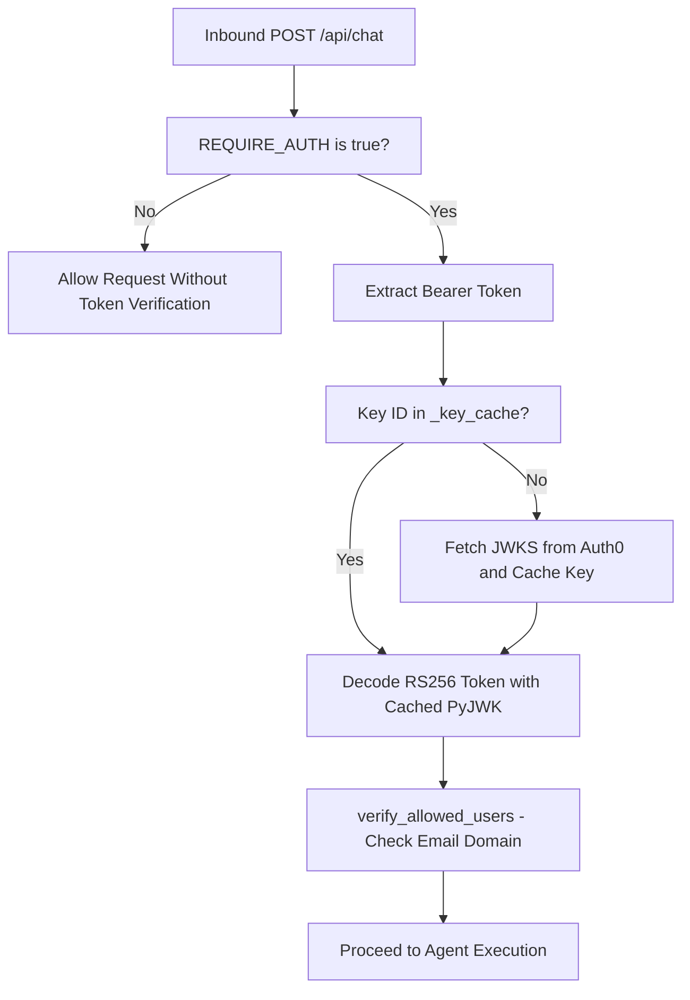

# Observability

The application integrates production-grade telemetry, rate limiting, authentication, and structured logging to provide complete visibility into model execution and PDF generation pipelines.

## 1. Structured Logging & High-Signal Tags

`src/chat_agent/config/logging_config.py` establishes centralized logging with colorized formatting. The execution engines emit standardized prefix tags for real-time monitoring:

### Model Dispatch & Retry Logging (`runner.py`)
- `[Model Selection]`: Logs candidate selection across `FIRST_CHOICE_MODELS` (Phase 1) or failover to `FALLBACK_GPT_MODEL` (Phase 2).
- `[Model Execution]`: Tracks request dispatch, transient retry backoffs (`503`, `429`, high demand), and success confirmations with character lengths.

```text
2026-09-29 02:48:15 | INFO     | runner | runner._run_with_retry_and_fallback:167 | [Model Selection] Phase 1 Attempt 1/3: Selected model 'gemini-flash-lite-latest' from FIRST_CHOICE_MODELS
2026-09-29 02:48:15 | INFO     | runner | runner._run_with_retry_and_fallback:172 | [Model Execution] Sending request to Google GenAI model: gemini-flash-lite-latest
2026-09-29 02:48:16 | INFO     | runner | runner._run_with_retry_and_fallback:176 | [Model Execution] ✅ Success response received from model 'gemini-flash-lite-latest'
```

### PDF Compilation & Delivery Logging (`tool_factory.py`)
- `[Notes Engine]` & `[Infographic Engine]`: Logs compilation starts, temporary file paths, byte sizes (Phase 1), and auto-upload triggers with Slack API delivery statuses (Phase 2).

```text
2026-09-29 02:48:16 | INFO     | tool_factory | tool_factory._generate_study_notes_pdf_sync:617 | [Notes Engine] Phase 1: ✅ PDF compiled successfully: /tmp/notes_123.pdf (142850 bytes)
2026-09-29 02:48:16 | INFO     | tool_factory | tool_factory._generate_study_notes_pdf_sync:623 | [Notes Engine] Phase 2: Triggering auto-upload to Slack (channel=C0123, thread_ts=17123.456)
2026-09-29 02:48:17 | INFO     | tool_factory | tool_factory._generate_study_notes_pdf_sync:626 | [Notes Engine] Phase 2: Slack upload finished with status=success for: /tmp/notes_123.pdf
```

## 2. In-Memory Rate Limiting

`src/chat_agent/config/rate_limiter.py` provides a FastAPI dependency backed by `pyrate-limiter`:

- **Client IP Tracking**: Rate limits are calculated per client IP address.
- **Enforced Thresholds**:
  - `GET /`: 30 requests / minute
  - `GET /api/health`: 60 requests / minute
  - `POST /api/chat`: 5 requests / minute
- **HTTP 429**: Exceeding rate limits returns `HTTP 429 Too Many Requests`.

## 3. Auth0 JWT Authentication

`src/chat_agent/config/auth0_config.py` implements secure OAuth2/OIDC token verification:

- **JWKS In-Memory Caching**: `get_jwks()` and `_key_cache` store parsed `jwt.PyJWK` objects in memory, avoiding redundant network lookups on every request.
- **Fast Claims Extraction**: `get_user_profile()` extracts identity claims directly from the decoded token payload to minimize network hops, falling back to `/userinfo` only when required.
- **User Authorization**: `verify_allowed_users` enforces email domain authorization (verifying email contains `"amrit"`).
- **Route Protection**: Attached to `POST /api/chat` via `Depends(auth0.require_auth())`. Active when `REQUIRE_AUTH=true`.



## 4. Upstash QStash Signature Verification

`src/chat_agent/config/qstash_authentication.py` provides a FastAPI dependency to authenticate incoming QStash webhook dispatches:

- **Dual-Key Rotation**: Initializes `qstash.Receiver` with `QSTASH_CURRENT_SIGNING_KEY` and `QSTASH_NEXT_SIGNING_KEY`.
- **Payload Integrity**: `verify_qstash` verifies the `Upstash-Signature` header against the raw UTF-8 request body, rejecting spoofed or replayed webhook requests.

## 5. Grafana Cloud & OpenTelemetry Tracing

`src/chat_agent/config/grafana_config.py` instruments the service for OpenTelemetry (OTel):

- **Activation**: Enabled when `GRAFANA_API_TOKEN` and `OTEL_EXPORTER_OTLP_ENDPOINT` are populated.
- **Traces & Logs**: Dispatches OTLP HTTP payloads to `{OTEL_EXPORTER_OTLP_ENDPOINT}/v1/traces` and `/v1/logs`.
- **Authentication**: HTTP Basic Auth with instance ID `1619876` and `GRAFANA_API_TOKEN`.
- **Auto-Instrumentation**: Automatically instruments FastAPI routes (`FastAPIInstrumentor`) and outgoing HTTP requests (`HTTPXClientInstrumentor`).
