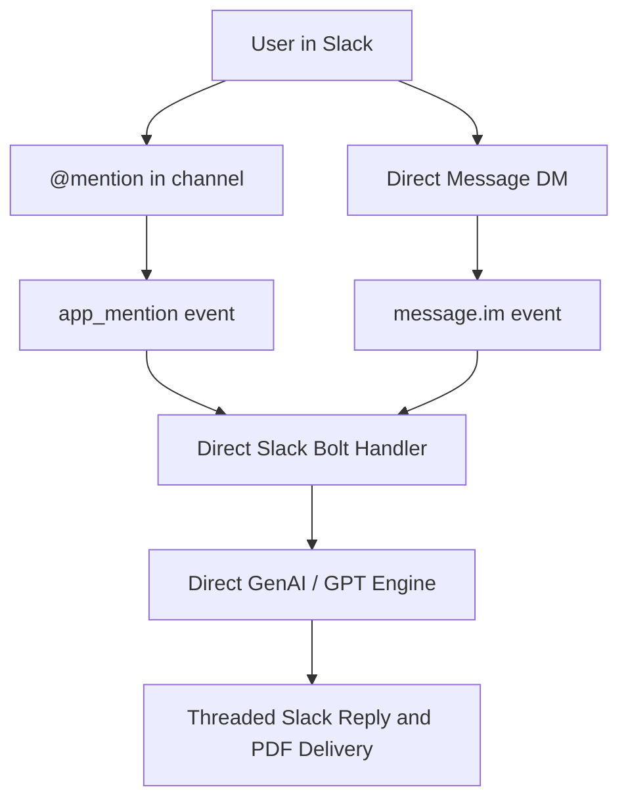

# Prerequisites

The agent process can connect to Slack and still not reply if configuration is missing. Socket Mode opens successfully, the socket receives heartbeats, and yet events never reach the agent if event subscriptions or OAuth scopes are omitted. This guide walks through every requirement to verify your setup.

## 1. Local Environment & Model Keys

Install the package in editable mode to make `src/` importable:

```bash
python -m pip install -e .
python -m chat_agent.main slack
```

`run_channels()` in `src/chat_agent/main.py` checks for a configured LLM key before reaching Slack:

```text
RuntimeError: Set USER_LLM_API_KEY in .env before starting the agent.
```

`src/chat_agent/config/settings.py` loads variables from `.env` at the project root (or via `DOTENV_LOCATION` / Infisical injection):

| Variable | Purpose |
| :--- | :--- |
| `USER_LLM_API_KEY` | Gemini API key (checked with `GEMINI_API_KEY` and `GOOGLE_API_KEY` fallbacks) |
| `OPENAI_API_KEY` | OpenAI API key for `FALLBACK_GPT_MODEL` (`gpt-6-luna`) failover |
| `TYPESAFE_API_KEY` | TypeSafe AI API key (optional; enables parallel System One `Noul` hint quality scoring) |
| `SLACK_BOT_TOKEN` | Bot user OAuth token (`xoxb-...`); required for posting messages and downloading attachments |
| `SLACK_APP_TOKEN` | App-level token (`xapp-...`) with `connections:write`; required for Socket Mode |

`python -m chat_agent.main slack` runs in the foreground. It must stay running to process Socket Mode events.

## 2. Slack App Configuration

### 1-Click Setup via Slack App Manifest

The fastest and most reliable way to configure the Slack app with all required scopes and event subscriptions is using Slack's App Manifest:

1. Navigate to [api.slack.com/apps](https://api.slack.com/apps) and click **Create New App**.
2. Select **From an app manifest**, choose your target Slack workspace, and paste the following JSON:

```json
{
  "display_information": {
    "name": "Aryhant Agent",
    "description": "Aryhant AI Assistant with Multimodal and PDF capabilities"
  },
  "features": {
    "bot_user": {
      "display_name": "Aryhant",
      "always_online": true
    }
  },
  "oauth_config": {
    "scopes": {
      "bot": [
        "app_mentions:read",
        "chat:write",
        "files:write",
        "im:history"
      ]
    }
  },
  "settings": {
    "event_subscriptions": {
      "bot_events": [
        "app_mention",
        "message.im"
      ]
    },
    "socket_mode_enabled": true
  }
}
```

3. **Generate App-Level Token**:
   - Go to **Basic Information** $\rightarrow$ **App-Level Tokens** $\rightarrow$ **Generate Token and Scopes**.
   - Set the token name (e.g. `socket-mode`), add the `connections:write` scope, and click **Generate**.
   - Copy this token (`xapp-...`) and set it as `SLACK_APP_TOKEN` in `.env`.
4. **Install App to Workspace**:
   - Go to **Install App** in the left sidebar $\rightarrow$ click **Install to Workspace** $\rightarrow$ **Allow**.
   - Copy the **Bot User OAuth Token** (`xoxb-...`) and set it as `SLACK_BOT_TOKEN` in `.env`.
5. **Invite Bot**:
   - In Slack, invite the bot to your channel by running `/invite @Aryhant`.

### Socket Mode and the App-Level Token

`start_slack()` in `src/chat_agent/slack/slack_app.py` builds an `AsyncApp` from the bot token and launches `AsyncSocketModeHandler` using the app-level token:

- **Socket Mode** must be toggled **On** in your Slack App configuration when running locally.
- An **App-Level Token** with the `connections:write` scope must be created and set as `SLACK_APP_TOKEN`.

Socket Mode establishes an outbound WebSocket to Slack, eliminating the need for a public IP, ngrok tunnel, or incoming webhook URL during local development.

### Bot Token Scopes

Configure the following OAuth scopes under **OAuth & Permissions**:

| Scope | Required for |
| :--- | :--- |
| `app_mentions:read` | Receiving `@mention` events in public/private channels |
| `chat:write` | Posting replies and updating message threads |
| `im:history` | Reading direct message conversations |
| `files:write` | Uploading compiled PDF study notes and infographics to Slack threads |

### Bot Event Subscriptions

Under **Event Subscriptions**, enable events and subscribe to the following bot events:

| Event | Required Scope | Trigger |
| :--- | :--- | :--- |
| `app_mention` | `app_mentions:read` | When users `@mention` the bot in joined channels |
| `message.im` | `im:history` | When users send a direct message (DM) to the bot |

> [!IMPORTANT]
> Socket Mode does **not** bypass event subscriptions. An app with an active WebSocket and no event subscriptions receives only PING/PONG heartbeats.

## 3. Inbound Event Routing

The Slack app registers two listeners in `src/chat_agent/slack/slack_app.py`:

- `app_mention`: Triggered when explicitly tagged in a channel the bot has joined.
- `message`: Triggered for direct messages (`channel_type in {"im", "mpim"}`).

Events from bots (carrying `bot_id` or `subtype == "bot_message"`) are automatically filtered out to prevent recursive loops.



| Inbound Method | Slack Event | Required Scope | Additional Requirement |
| :--- | :--- | :--- | :--- |
| `@mention` in channel | `app_mention` | `app_mentions:read` | Bot must be invited to channel |
| Direct message | `message.im` | `im:history` | Direct conversation with bot |
| Thread reply in DM | `message` | `im:history` | Existing conversation thread |
| PDF File Delivery | N/A | `files:write` | Initiated by study notes / infographic tools |

## 4. Installation & Reinstallation Traps

Modifying OAuth scopes requires **reinstalling the app to your workspace**:

- Scopes added in the Slack App Console are requests. They are only granted when the app is installed.
- Editing scopes after installation does not update active token permissions.
- Always click **Reinstall to Workspace** under **Install App** after changing scopes or event subscriptions.

## 5. Channel Membership

`app_mention` events are only delivered for channels the bot has joined. Invite the bot:

```text
/invite @Aryhant
```

## 6. Configuration Verification

Verify token validity and active scopes using the Slack SDK:

```bash
python -c "import os; from slack_sdk import WebClient; r=WebClient(token=os.environ['SLACK_BOT_TOKEN']).auth_test(); print('BOT='+r['user']); print('USER_ID='+r['user_id']); print('SCOPES='+(r.headers.get('x-oauth-scopes') or 'NONE'))"
```

## Troubleshooting Matrix

| Symptom | Probable Cause | Resolution |
| :--- | :--- | :--- |
| Socket connects, only PING/PONG, no replies | Missing event subscriptions, or app token belongs to different app | Subscribe to `app_mention` and `message.im`; verify token origins |
| DMs ignored, channel mentions work | `im:history` scope missing or app not reinstalled | Add `im:history` scope and reinstall app |
| PDF upload fails with `missing_scope` | `files:write` scope missing from Bot Token | Add `files:write` scope under OAuth & Permissions and reinstall app |
| Scope visible in console but missing in `auth.test` | App was not reinstalled after scope update | Click Reinstall to Workspace |
| `@mention` in channel ignored | Bot is not a member of the channel | Run `/invite @Aryhant` in the target channel |
| Process exits at startup | Missing `USER_LLM_API_KEY` | Set `USER_LLM_API_KEY` in `.env` |
