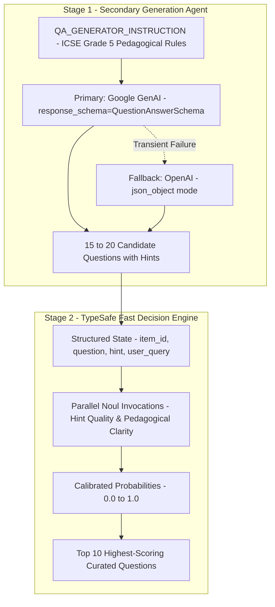

# Question Generation & TypeSafe Curation

Aryhant features a specialized two-stage question generation and evaluation pipeline designed for St. Xavier's Grade 5 ICSE syllabus. The system uses a secondary LLM agent to generate an oversampled batch of candidate practice questions and pedagogical hints, followed by TypeSafe AI's System One model (`Jev`) to evaluate hint clarity and select the top 10 highest-quality items.

## Generation & Curation Pipeline



## Core Components

<Tree>
  <Tree.Folder name="src" defaultOpen>
    <Tree.Folder name="chat_agent" defaultOpen>
      <Tree.Folder name="agents" defaultOpen>
        <Tree.File name="prompt.py" highlight />
        <Tree.File name="question_generator.py" highlight />
        <Tree.File name="runner.py" />
      </Tree.Folder>
      <Tree.Folder name="schema" defaultOpen>
        <Tree.File name="fundamental_schema.py" highlight />
      </Tree.Folder>
      <Tree.Folder name="utils">
        <Tree.Folder name="fast_decision" defaultOpen>
          <Tree.File name="typesafe_integrator.py" highlight />
        </Tree.Folder>
      </Tree.Folder>
    </Tree.Folder>
  </Tree.Folder>
</Tree>

---

## 1. Secondary Generation Agent

The secondary question generator operates in `src/chat_agent/agents/question_generator.py` and relies on `QA_GENERATOR_INSTRUCTION` defined in `src/chat_agent/agents/prompt.py`.

### Pedagogical Guidelines
1. **Target Audience**: St. Xavier's Grade 5 students (~10 years old, ICSE curriculum).
2. **Oversampling (15–20 Items)**: Generates 15 to 20 candidate questions across arithmetic, word problems, and conceptual definitions.
3. **Guiding Hints**: Hints must guide the student's problem-solving reasoning without revealing the final answer directly.
4. **Plain-Text Math**: Strict avoidance of LaTeX markup (`$...$`, `\\frac`). Plain-text formatting (`3/5`, `cm²`, `x`, `÷`) is strictly enforced.

### Function Signature
```python
async def generate_candidate_questions(
    topic: str,
    min_count: int = 15,
    max_count: int = 20,
) -> list[QuestionAnswerSchema]:
    """Generate 15-20 candidate questions with pedagogical hints using the secondary LLM agent."""
```

---

## 2. TypeSafe AI Fast Decision Engine

The curation engine in `src/chat_agent/utils/fast_decision/typesafe_integrator.py` uses TypeSafe's **System One** API (`Jev`) via the `typesafe-sdk`.

### Why System One?
Unlike autoregressive chat models that generate textual explanations, TypeSafe's System One model directly returns typed decisions and calibrated probabilities in milliseconds.

* **`Noul` Primitive**: Binary condition evaluator that returns a calibrated probability $P(\text{yes}) \in [0.0, 1.0]$.
* **Parallel Execution**: Questions for all candidates are evaluated concurrently against the shared state.
* **Safe State Referencing**: Untrusted user inputs and candidate questions are stored in `state`; instructions reference backticked state paths (`item_{id}.hint`, `item_{id}.question`, `user_query`) to eliminate prompt injection risks.

### Function Signature
```python
async def get_feedback(
    qnah: list[QuestionAnswerSchema],
    user_input: str = "",
) -> list[QuestionAnswerSchema]:
    """Evaluate hint quality using TypeSafe Noul probability (0.0 to 1.0) and return top 10 by score."""
```

---

## 3. Data Schema

The data model is defined in `src/chat_agent/schema/fundamental_schema.py`:

```python
from typing import Optional
from pydantic import BaseModel


class QuestionAnswerSchema(BaseModel):
    """Schema representing a question, hint, and evaluation score."""
    id: int
    question: str
    hint: str = ""
    score: Optional[float] = None
```

---

## 4. Graceful Degradation & Resilience

The question pipeline is built for high availability and zero disruption:

| Scenario | Behavior |
| :--- | :--- |
| `TYPESAFE_API_KEY` configured & valid | Full 2-stage pipeline: candidates generated $\rightarrow$ hints scored via TypeSafe $\rightarrow$ top 10 curated questions returned. |
| `TYPESAFE_API_KEY` missing (`typesafe_ready == False`) | Graceful bypass: logs info message and returns the first 10 candidate questions without scoring. |
| TypeSafe API timeout / network error | Exception catch & fallback: logs warning and immediately returns the first 10 candidate questions. |
| Primary Google GenAI failure | Automatic failover to OpenAI structured `json_object` completion. |

---

## 5. Thread-Safe Singleton Client

The TypeSafe client uses an `asyncio.Lock()` double-checked locking pattern in `typesafe_integrator.py` to prevent duplicate client initialization across concurrent async tasks:

```python
_async_typesafe_client: Optional[AsyncTypeSafeClient] = None
_client_lock: asyncio.Lock = asyncio.Lock()


async def get_client() -> AsyncTypeSafeClient:
    """Return a thread-safe singleton AsyncTypeSafeClient instance."""
    global _async_typesafe_client
    if _async_typesafe_client is None:
        async with _client_lock:
            if _async_typesafe_client is None:
                _async_typesafe_client = AsyncTypeSafeClient(api_key=settings.typesafe_api_key)
    return _async_typesafe_client
```
