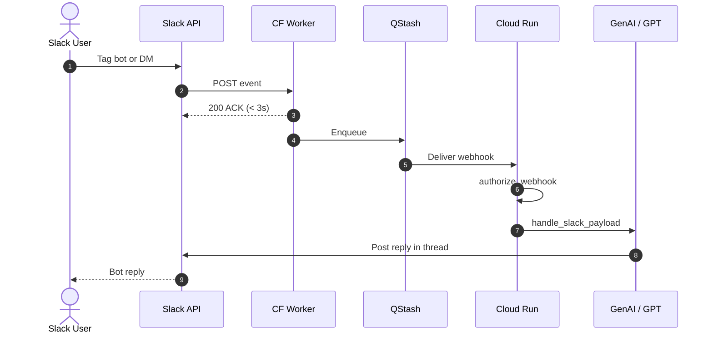

# Slack channel

The codebase supports two distinct operational modes for Slack: **Socket Mode** for local development and **HTTP Events API** with edge proxying for scale-to-zero cloud deployments.

## 1. Local Development: Socket Mode

In local development, `src/chat_agent/slack/slack_app.py` initializes a `slack_bolt.AsyncApp` using `SLACK_BOT_TOKEN`. The app connects to Slack's WebSocket gateway via `AsyncSocketModeHandler` using `SLACK_APP_TOKEN`:

```bash
python -m chat_agent.main slack
```

- **Outbound WebSocket**: No public IP or tunneling software (e.g., ngrok) is required.
- **Required Tokens**: `ARYHANT_SLACK_BOT_TOKEN` (`xoxb-...`) and `ARYHANT_SLACK_APP_TOKEN` (`xapp-...`).
- **Prerequisites**: Socket Mode enabled in the Slack console, bot events `app_mention` and `message.im` subscribed, and bot scopes (`app_mentions:read`, `chat:write`, `im:history`, `files:write`, `users:read.email`) granted.

### Quick Start: 1-Click Manifest Setup

To configure a new Slack bot in under a minute without manual checkbox setup:

1. Create a new app at [api.slack.com/apps](https://api.slack.com/apps) $\rightarrow$ select **From an app manifest**.
2. Paste the official manifest JSON from [Prerequisites](/prerequisites#1-click-setup-via-slack-app-manifest).
3. Under **Basic Information** $\rightarrow$ **App-Level Tokens**, generate an `xapp-...` token with scope `connections:write` (`ARYHANT_SLACK_APP_TOKEN`).
4. Under **Install App**, click **Install to Workspace** and copy the `xoxb-...` token (`ARYHANT_SLACK_BOT_TOKEN`).
5. Run `python -m chat_agent.main slack` and invite the bot to your channels with `/invite @Aryhant`.

## 2. Production: HTTP Events API & Scale-to-Zero

In serverless environments like Google Cloud Run, holding open persistent WebSockets is inefficient and prevents scaling down to zero instances. Instead, the bot processes webhook payloads delivered to `POST /webhooks/slack`.

### Scale-to-Zero Forwarding Architecture

Because Cloud Run cold starts can take 5–10 seconds, and Slack's Events API requires an HTTP 200 acknowledgment within **3 seconds**, direct webhook delivery risks timeouts and repetitive Slack retries.

To resolve this, a lightweight Cloudflare Worker (`proxies/cloudflare-slack-ack.js`) acknowledges Slack in under 50ms and enqueues the event into **Upstash QStash**, which retries delivery until Cloud Run wakes up.



### Setup Instructions

1. **Obtain QStash Credentials**:
   - In the [Upstash Console](https://console.upstash.com/), copy `QSTASH_TOKEN`, `QSTASH_CURRENT_SIGNING_KEY`, and `QSTASH_NEXT_SIGNING_KEY`.
2. **Generate `ARYHANT_WEBHOOK_SHARED_SECRET`**:
   - Generate a secure 32-byte secret:
     ```bash
     python -c "import secrets; print(secrets.token_hex(32))"
     ```
   - Store this secret in your Cloud Run environment variables or GCP Secret Manager.
3. **Deploy the Cloudflare Worker**:
   - Deploy `proxies/cloudflare-slack-ack.js` to Cloudflare Workers.
   - Configure environment secrets:
     - `QSTASH_TOKEN`: Upstash QStash token.
     - `CLOUD_RUN_WEBHOOK`: `https://<YOUR_CLOUD_RUN_URL>/webhooks/slack`.
     - `ARYHANT_WEBHOOK_SHARED_SECRET`: The shared secret generated in step 2.
4. **Configure Slack App Request URL**:
   - In [Slack App Console](https://api.slack.com/apps) $\rightarrow$ **Event Subscriptions**, set **Request URL** to the Cloudflare Worker URL.
   - The worker automatically handles the `url_verification` challenge.
5. **Disable Socket Mode**:
   - In the Slack App Console, toggle **Socket Mode** to **Off**.
   - Under **Install App**, click **Reinstall to Workspace**.

> [!IMPORTANT]
> If Socket Mode is left enabled in the Slack Console, Slack will ignore your Request URL and route all events over WebSocket. Always disable Socket Mode when switching to the HTTP scale-to-zero path.

> [!TIP]
> For the comprehensive step-by-step setup guide with Cloudflare Dashboard / Wrangler commands, environment secret tables, and verification procedures, see [Cloudflare & QStash Scale-to-Zero Deployment](/deployment).

## 3. Payload Processing & Security

`src/chat_agent/slack/slack_http.py` and `src/chat_agent/webhooks.py` handle inbound HTTP payloads:

- **Webhook Authorization**: `authorize_webhook` verifies requests against `ARYHANT_WEBHOOK_SHARED_SECRET` (`X-Webhook-Secret` or `X-Qstash-Forward-X-Webhook-Secret` headers using constant-time `hmac.compare_digest`) or direct Slack v0 signatures (`X-Slack-Signature` + `X-Slack-Request-Timestamp` with a 5-minute timestamp window).
- **Event Filtering**: `should_handle_event` accepts `app_mention` events and direct messages (`channel_type in {"im", "mpim"}`), ignoring bot messages to prevent feedback loops.
- **Event Deduplication**: `is_duplicate_event` caches event IDs (`event_id`, `client_msg_id`, or `channel:ts`) for 10 minutes (`_DEDUP_TTL_SECONDS = 600`). If an unexpected exception occurs, `remove_dedup_event` evicts the ID to permit redelivery.
- **Threaded Sessions**: Sessions are scoped to `slack:{channel}:{thread_ts}` for threads or `slack:{channel}:{msg_ts}` for top-level messages.
- **Multimodal Downloads**: When `MULTIMODAL_ENABLED=true`, attachments are extracted and downloaded from Slack's authenticated private CDN using the bot token.

## 4. Automated PDF File Uploads

When study notes or lesson infographics are generated, `upload_file_to_slack` in `src/chat_agent/tools/tool_factory.py` delivers the compiled PDF directly to the active Slack conversation thread:

- **Two-Step External Upload**: Uses Slack's `files.getUploadURLExternal` to request an upload URL and completes delivery via `files.completeUploadExternal`.
- **Security Boundary**: `_is_allowed_upload_path` verifies that uploaded files originate from authorized operating system temporary directories or the designated application workspace.
- **Thread Targeting**: Attaches files to the exact initiating thread timestamp (`thread_ts`) or posts to the channel.

> [!NOTE]
> Bot tokens require the `files:write` OAuth scope to upload files to Slack channels.

## 5. Structured Block Kit Formatting

`src/chat_agent/slack/post_generator.py` translates raw markdown responses from the agent into structured Slack Block Kit blocks:

```python
from chat_agent.slack.post_generator import generate_slack_post

post = generate_slack_post(reply_text)
# Returns: {"text": fallback_text, "blocks": [...]}
```

### Block Kit Features:

- **Fallback Notification Text**: Generates accessible plain text summary (first 200 characters) for push notifications and screen readers.
- **Header & Divider Blocks**: Formats markdown headings (`# Title`) into Slack `header` blocks followed by `divider` lines.
- **Context Blocks**: Converts footer notes, concept hints, source citations, and timestamps (prefixed with `Note:`, `Hint:`, `Context:`, `Source:`, or `Timestamp:`) into styled `context` blocks.
- **Paragraph Chunking**: Splits paragraphs exceeding 2800 characters to adhere to Slack's 3000-character section limit.
- **20-Block Ceiling**: Enforces a strict ceiling of 20 blocks (`MAX_BLOCKS = 20`) to stay within Slack's message payload limits, appending a truncation notice when needed.

## 6. Personal Memory & Preferences Modal (`/preferences`)

Students and teachers can inspect and manage what Aryhant remembers about their learning habits and preferences using the `/preferences` slash command:

- **Private Block Kit Modal**: Running `/preferences` calls `client.views_open`, presenting a private popup showing mastered skill badges and active educational preferences.
- **Interactive Deletion**: Each preference item includes an interactive `Delete` button (`action_id="delete_memory_action"`). Clicking it triggers `client.views_update` to refresh the modal in real time without posting anything to the channel.
- **Clear All Preferences**: A danger-styled button with a confirmation popup allows students to exercise their right to be forgotten.
- **Background Learning**: In the background after message replies, Aryhant distills learning habits and updates the Turso memory store without adding latency to the student's Slack response.

See [Turso memory and preferences](/turso-memory-preferences) for complete architecture, schema details, and manual Slack testing guides.

## 7. Administrative & Telemetry Audit (`/admin`, `/audit`)

Authorized workspace members and operators can trigger autonomous system health audits and data hygiene maintenance using `/admin` or `/audit`:

- **Instant Acknowledgment**: Slack slash commands must acknowledge receipt within 3 seconds. The handler immediately returns an ephemeral confirmation:
  > *"Running system audit and operational maintenance..."*
- **Background Execution**: A background task executes `AdminAgent.run(job_id, ...)`:
  1. Purges session task records older than 15 days (`SessionTaskService.delete_records_older_than(15)`).
  2. Aggregates 7-day operational telemetry metrics (`SessionTaskService.get_table_metrics(7)`).
  3. Diagnoses recent failures using `search_context7` and `search_web`.
  4. Sanitizes error signatures and absolute paths.
  5. Posts the audit report directly to the channel or invocation context.
- **Natural Language Triggers**: The auditor can also be triggered via app mentions containing phrases like `@Aryhant system health` or `@Aryhant audit system`.

See [Administrative & Operations Auditor](/admin-agent) for full technical architecture and tool calling mechanics.

## 8. Access Control & User Email Whitelist (`ARYHANT_ALLOWED_EMAILS`)

To restrict who can interact with the Slack bot and prevent unauthorized token consumption:

- **Environment Variable**: `ARYHANT_ALLOWED_EMAILS` (comma-separated list of permitted email addresses, case-insensitive).
  ```bash
  ARYHANT_ALLOWED_EMAILS="student1@school.org, student2@domain.com, teacher@school.org"
  ```
- **Prerequisite Scope**: The Slack Bot token must have the **`users:read.email`** Bot Token Scope. Without this scope, Slack omits email addresses from user profile lookups.
- **Deterministic Polite Denial**: When an unauthorized user sends a message or invokes `/preferences`, the bot detects that their email is not on the whitelist and immediately replies with a polite deterministic notice:
  > *"Hello! Access to this assistant is restricted to authorized users. Your email address is not on the permitted list. Please contact your workspace administrator if you need access."*
  The LLM runner (`run_agent`) and Turso memory queries are completely skipped, saving API costs and tokens.
- **Open Access Mode**: If `ARYHANT_ALLOWED_EMAILS` is empty or unset (`""`), email filtering is inactive (open access mode).
