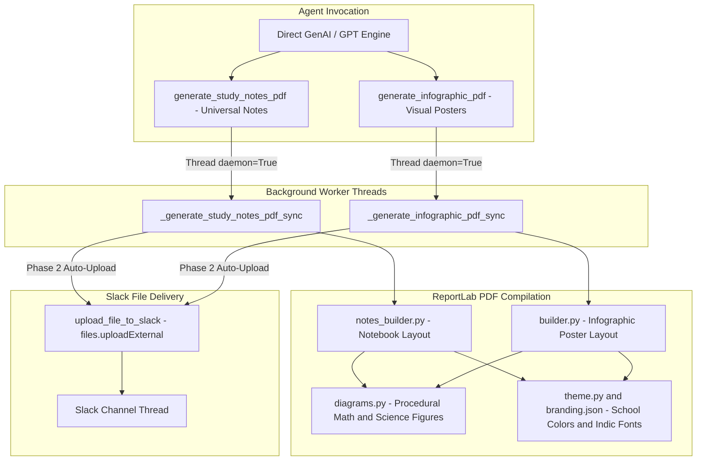

# Study notes and infographics

The agent is equipped with a high-fidelity visual PDF compilation engine that generates two distinct formats for both general everyday learning and St. Xavier's Grade 5 ICSE curriculum topics: **Handwritten Notebook Study Notes** and **Lesson Infographic Posters**. Both tools execute asynchronously on background worker threads and auto-upload the resulting document to the requesting Slack thread without blocking immediate text replies.

## Architecture



## 1. Universal Handwritten Notebook Notes (`generate_study_notes_pdf`)

Located in `src/chat_agent/infographics/notes_builder.py`, this engine compiles realistic notebook-style study notes on **any topic** (science lessons, math, literature, technology guides, daily planning, or general knowledge):

- **Grid/Lined Background**: Renders ruled or grid notebook page backgrounds with authentic margin lines and page numbers (`1 of N`).
- **Wavy Underlines & Tag Pills**: Formats chapter titles with hand-drawn decorative underlines and subject metadata pill badges (Subject, Grade 5 / Category, Date).
- **Indic Font Support**: Detects Bengali and Hindi script runs and wraps them in an Indic-capable TrueType font (`register_pdf_fonts()` in `src/chat_agent/infographics/config.py` discovers Nirmala UI on Windows and Noto Sans Devanagari/Bengali or Lohit on Linux; Cloud Run images need `fonts-noto-core` in the Dockerfile). Pillow diagram labels select the same Indic font via `get_pillow_font(for_text=...)`. Known limitation: ReportLab performs no OpenType shaping, so conjuncts and reordered matras may render imperfectly.
- **Side Margin Tips**: Embeds sticky-note style callout boxes for "Pro-Tips", "Did You Know?", or memory tricks.
- **Structured Sections**: Automatically lays out key concepts, definitions, bullet points, tables, and procedural figures.

```python
from chat_agent.tools.tool_factory import generate_study_notes_pdf

# Triggered directly by the agent model on any topic
res = generate_study_notes_pdf(
    title="Photosynthesis and Plant Nutrition",
    content="Plants make their food using sunlight, water, and carbon dioxide...",
    subject="Science",
    tags=["Grade 5", "ICSE", "Botany"],
    visual="science",
    channel="C0123456789",
    thread_ts="1712345678.901234",
)
# Returns immediately: {"status": "queued", "title": "Photosynthesis...", ...}
```

## 2. Universal Lesson Infographic Posters (`generate_infographic_pdf`)

Located in `src/chat_agent/infographics/builder.py`, this engine builds visual poster summaries across academic subjects, personal hobbies, or technical concepts:

- **Hero Header**: Styled title banner with school branding (`src/chat_agent/infographics/branding.json`), grade level, and subject icon.
- **Card-Based Visual Layout**: Arranges concepts into multi-column summary cards, key term boxes, and illustrative callouts.
- **Quiz & Practice Section**: Embeds multiple-choice or short-answer practice questions at the bottom of the poster.
- **Badge Indicators**: Highlights key formulas, rules, and mnemonic devices.

```python
from chat_agent.tools.tool_factory import generate_infographic_pdf

lesson_payload = {
    "title": "Fractions and Decimals",
    "subject": "Mathematics",
    "cards": [
        {"heading": "Like Fractions", "text": "Fractions with the same denominator (e.g. 1/5 and 3/5)."},
        {"heading": "Proper vs Improper", "text": "Proper: Numerator < Denominator. Improper: Numerator >= Denominator."},
    ],
    "quiz": [
        {"question": "What is 2/5 + 1/5?", "answer": "3/5"}
    ]
}

res = generate_infographic_pdf(
    lesson_data=lesson_payload,
    channel="C0123456789",
    thread_ts="1712345678.901234",
)
```

## 3. Procedural Diagrams (`diagrams.py`)

`src/chat_agent/infographics/diagrams.py` generates pure vector illustrations using ReportLab `Drawing` and `Shape` primitives:

- **Mathematical Curves**: Parabolas, sine/cosine waves, coordinate grids, and geometric polygons.
- **Physics & Chemistry**: Circuit diagrams, atomic structure schematics, and heat transfer flows.
- **Biology**: Plant cell schematics, flower anatomy, and water cycle charts.

All diagrams are scaled to maintain high visual clarity without raster pixelation.

## 4. Automated Slack Thread Delivery

When `channel` and `thread_ts` are supplied:

1. **Phase 1: PDF Compilation**: The background thread compiles the PDF into a secure OS temporary path and validates file size.
2. **Phase 2: Slack Delivery**: `upload_file_to_slack` delivers the file using Slack's modern external upload flow:
   - Queries `files.getUploadURLExternal` for an authenticated Amazon S3 upload URL.
   - Uploads the raw bytes via HTTP POST to the presigned URL.
   - Calls `files.completeUploadExternal` with `channel_id` and `thread_ts` to attach the file directly to the conversation thread.

> [!IMPORTANT]
> Delivering files to Slack threads requires the `files:write` Bot Token scope in the Slack Developer Console.
