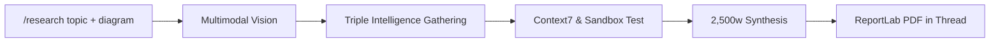

# Technical Research Flow (`/research`)

The `/research` command activates Aryhant's **Dedicated Technical Researcher Agent**—a specialized pipeline designed to investigate engineering architectures, distributed systems, algorithms, and low-level software mechanics.

It delivers a comprehensive **~2,500-word ReportLab PDF Whitepaper** directly into the Slack conversation thread, tracked live by an interactive, Redis-backed status board.



---

## Key Features

1. **Target Volume**: ~2,500 words across 6 mandatory technical sections.
2. **Context7 Verified Code**: Queries Context7 Search v3 (`https://context7.com/api/v3/search`) to retrieve authentic library implementations and code snippets.
3. **Nebius Sandbox Verification**: Candidate code snippets are executed and tested in isolated microVM sandboxes via Nebius TokenFactory (`contree-sdk` / REST API). Execution status, exit code, and stdout/stderr are embedded directly in Section 3 of the report.
4. **Google AI Overview**: Scrapes Google's AI Overview text blocks and citations via SerpApi (`engine="google_ai_overview"` with `page_token`).
5. **Tavily Mini-Research Polling**: Submits async research tasks to Tavily (`model="mini"`) and polls until completion with session tracking.
6. **Multimodal Diagram Ingestion**: Ingests user-attached architecture diagrams or flowcharts, transcribes components, and embeds the diagram into the PDF report.
7. **Redis Fault Tolerance**: All job states and task milestones are persisted under `aryhant:job:{job_id}` in Upstash Redis with a 24-hour TTL and in-memory fallback.
8. **Live Slack TODO Board**: Posts dynamic Block Kit progress rows that advance in real time (`⬜` $\to$ `🔄` $\to$ `✅`) via Slack `chat.update`.

---

## Directory Architecture

<Tree>
  <Tree.Folder name="src/chat_agent">
    <Tree.Folder name="tools">
      <Tree.File name="serpapi_tool.py" />
      <Tree.File name="tavily_research_tool.py" />
      <Tree.File name="context7_tool.py" />
      <Tree.File name="sandbox_tool.py" />
      <Tree.File name="tool_factory.py" />
    </Tree.Folder>
    <Tree.Folder name="research">
      <Tree.File name="models.py" />
      <Tree.File name="engine.py" />
      <Tree.File name="research_agent.py" />
      <Tree.File name="pdf_builder.py" />
      <Tree.File name="todo_tracker.py" />
    </Tree.Folder>
    <Tree.Folder name="services">
      <Tree.File name="redis_research_store.py" />
    </Tree.Folder>
  </Tree.Folder>
</Tree>

---

## 6-Section Technical Blueprint

Every generated report fulfills strict section quotas:

| Section | Focus | Target Words |
| :--- | :--- | :--- |
| **1. Executive Summary & Scope** | Problem statement, architectural boundaries, and key conclusions | ~300 words |
| **2. Architectural & Foundational Mechanics** | Low-level design, data flow diagrams, memory models, and state machines | ~600 words |
| **3. Concrete Implementation & Verified Code** | Context7 library implementations and Nebius sandbox execution outputs | ~600 words |
| **4. Failure Modes, Edge Cases & Bottlenecks** | Race conditions, memory leaks, concurrency locks, and debugging steps | ~450 words |
| **5. Quantitative Benchmarks & Trade-offs** | Throughput, latency, resource utilization, and architectural tradeoffs | ~350 words |
| **6. Production Guidance & References** | Hardening guidelines, deployment checklists, and numbered citations | ~200 words |

---

## Usage in Slack

### Slash Command
```text
/research Linux io_uring architecture vs epoll high-throughput networking
```

### Mention with Architecture Diagram
Attach an image (e.g. `system_architecture.png`) and type:
```text
@Aryhant /research Analyze this distributed event-driven pipeline and identify scalability bottlenecks
```

### Live Status Board Progression
When invoked, the bot responds with an initial status message:
```text
🔍 Technical Research In Progress
Topic: Linux io_uring architecture vs epoll high-throughput networking
Scope: Technical Whitepaper (~2,500 words)

✅ 1. Analyze topic, visual context & plan queries
✅ 2. Gather Google AI Overview, Tavily Mini-Research & Context7 code
🔄 3. Verify code execution in Nebius Sandbox
⬜ 4. Synthesize technical publication (~2,500 words)
⬜ 5. Compile ReportLab PDF & upload to Slack
```

Upon completion, the compiled PDF publication is uploaded to the thread and an Executive Summary is posted.
