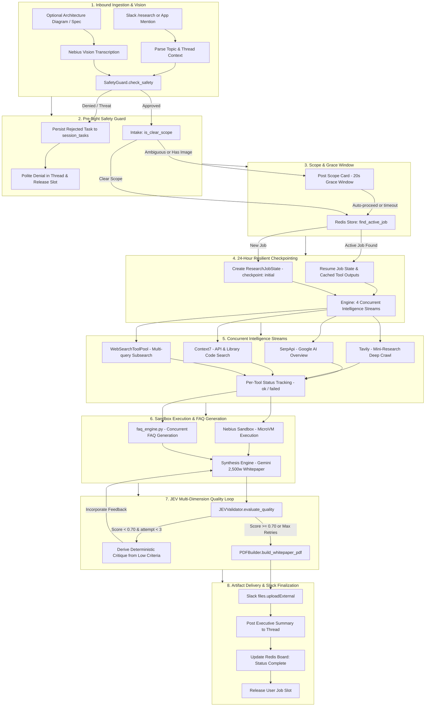

# Technical Research Flow (`/research`)

The `/research` command activates Aryhant's **Dedicated Technical Researcher Agent** (Role 3)—an autonomous, fault-tolerant research pipeline engineered to investigate distributed architectures, low-level software mechanics, algorithms, and system design.

It conducts multi-stream intelligence gathering, verifies live code snippets in isolated microVMs, dynamically formulates FAQs, enforces strict multi-dimensional quality evaluation with JEV/Noul, and compiles a **~2,500-word ReportLab PDF Whitepaper** directly into the Slack conversation thread.

---

## End-to-End Research Architecture Flow

The complete execution lifecycle from inbound slash command to final PDF delivery:



---

## Core Architectural Pillars

### 1. Pre-flight Safety Guard (`safety_guard.py`)
Before allocating compute or querying external APIs, topics undergo dual-layer pre-flight safety screening:
- **Heuristic Pattern Screening**: Evaluates input against compiled regex patterns (`SAFETY_PATTERNS`) targeting privilege escalation, exploit generation, credential harvesting, malware authoring, and unauthorized access directives.
- **JEV Classification (Role 3)**: Performs fast statistical classification for borderline queries.
- **Audit Persistence**: If rejected, a record is persisted to Turso `session_tasks` via `SessionTaskService.acreate_task(..., status="rejected")` for administrative compliance auditing, the user's concurrency slot is released, and a polite denial is posted in the thread.

### 2. Scope Clarification Grace Window (`intake.py`)
- **Scope Formulation**: Analyzes the topic and generates target audiences, focus areas, and explicit success criteria.
- **Clarity Detection**: Evaluates query specificity via `is_clear_scope(topic, has_attachments)` with stop-word filtering.
- **Grace Window**: Clear technical queries proceed instantly. Ambiguous or multi-clause topics post an informational scope card and wait 20 seconds before auto-proceeding with the inferred scope. Resumed jobs skip the wait entirely.

### 3. 24-Hour Checkpoint Resiliency (`redis_research_store.py`)
- **Secondary Indexing**: Active jobs are indexed under `aryhant:active_job:thread:<channel_id>:<thread_ts>` and `aryhant:active_job:user:<user_id>:<topic_hash>`.
- **Failover & Resume**: If a container restarts or network drops, a subsequent request within 24 hours locates the active job via `find_active_job` and resumes execution from its last recorded checkpoint (`initial`, `planned`, `gathered`, `verified`, `synthesized`).
- **Sliding 24-Hour TTL**: State is persisted in Upstash Redis under `aryhant:job:<job_id>` with automatic 24-hour expiration (`REDIS_TTL_SEC = 86400`).

### 4. 4-Stream Concurrent Intelligence Gathering (`engine.py`)
Four asynchronous intelligence streams execute concurrently:
1. **Google AI Overview** via SerpApi (`engine="google_ai_overview"` with `page_token`).
2. **Tavily Mini-Research** (`model="mini"`) with deep-crawl polling.
3. **Context7 Code Search** (`https://context7.com/api/v3/search`) for verified library implementations.
4. **WebSearchToolPool Subsearch** for domain-specific query fan-out.

#### Poison-Free Per-Tool Caching
Outputs are stored as structured entries (`ToolOutputEntry(output=..., status="ok"|"failed", fetched_at=...)`). If a transient network glitch causes one stream to fail, its empty result is not permanently cached; on resume, failed streams are retried while successful outputs are reused from cache.

### 5. Nebius Sandbox Code Verification
Candidate code snippets extracted from Context7 are executed inside isolated microVM sandboxes via the Nebius TokenFactory (`contree-sdk` / REST API). The exact execution exit code, stdout, and stderr are captured and embedded into Section 3 of the final whitepaper.

### 6. Concurrent FAQ Generation (`faq_engine.py`)
While technical synthesis is underway, a dedicated FAQ engine concurrently queries the research corpus to formulate high-frequency technical questions and answers. These are cached in `tool_outputs["faq"]` and rendered in the appendix of the report.

### 7. JEV Multi-Dimension Quality Loop (`jev_validator.py`)
The synthesized publication is evaluated across 4 objective quality dimensions using TypeSafe AI System One (`Noul`):
- `technical_accuracy`: Correctness of architectural explanations and system mechanics.
- `structure`: Compliance with the 6-section quota and ReportLab formatting rules.
- `code_depth`: Quality of verified code snippets and sandbox execution outputs.
- `production_guidance`: Actionability of edge-case, failure-mode, and benchmark analyses.

#### Deterministic Critique & Automated Retry
If the quality score falls below threshold (`0.60`), the validator deterministically derives actionable critique from the failing criteria. The synthesis engine automatically incorporates this critique and retries synthesis (up to 3 attempts).

### 8. Single-Thread Transparency (`[INTERNAL]` Notices)
All progress notifications—including intelligence stream status, sandbox execution outputs, and JEV critique loops—are posted directly into the root Slack conversation thread with `[INTERNAL]` tags, keeping users informed without cluttering other channels.

---

## Directory Architecture

<Tree>
  <Tree.Folder name="src/chat_agent" defaultOpen>
    <Tree.Folder name="research" defaultOpen>
      <Tree.File name="models.py" highlight />
      <Tree.File name="safety_guard.py" highlight />
      <Tree.File name="intake.py" highlight />
      <Tree.File name="engine.py" highlight />
      <Tree.File name="faq_engine.py" highlight />
      <Tree.File name="jev_validator.py" highlight />
      <Tree.File name="research_agent.py" highlight />
      <Tree.File name="pdf_builder.py" highlight />
      <Tree.File name="todo_tracker.py" highlight />
    </Tree.Folder>
    <Tree.Folder name="services" defaultOpen>
      <Tree.File name="redis_research_store.py" highlight />
      <Tree.File name="session_task_service.py" highlight />
    </Tree.Folder>
    <Tree.Folder name="tools" defaultOpen>
      <Tree.File name="serpapi_tool.py" />
      <Tree.File name="tavily_research_tool.py" />
      <Tree.File name="context7_tool.py" />
      <Tree.File name="sandbox_tool.py" />
      <Tree.File name="tool_factory.py" />
    </Tree.Folder>
  </Tree.Folder>
</Tree>

---

## 6-Section Technical Blueprint

Every generated report fulfills strict section quotas:

| Section | Focus | Target Words |
| :--- | :--- | :--- |
| **1. Executive Summary & Scope** | Problem statement, architectural boundaries, and key conclusions | ~300 words |
| **2. Architectural & Foundational Mechanics** | Low-level design, data flow diagrams, memory models, and state machines | ~600 words |
| **3. Concrete Implementation & Verified Code** | Context7 library implementations and Nebius sandbox execution outputs | ~600 words |
| **4. Failure Modes, Edge Cases & Bottlenecks** | Race conditions, memory leaks, concurrency locks, and debugging steps | ~450 words |
| **5. Quantitative Benchmarks & Trade-offs** | Throughput, latency, resource utilization, and architectural tradeoffs | ~350 words |
| **6. Production Guidance & References** | Hardening guidelines, deployment checklists, and numbered citations | ~200 words |

---

## Usage in Slack

### Slash Command
```text
/research Linux io_uring architecture vs epoll high-throughput networking
```

### Mention with Architecture Diagram
Attach an image (e.g. `system_architecture.png`) and type:
```text
@Aryhant /research Analyze this distributed event-driven pipeline and identify scalability bottlenecks
```

### Live Status Board Progression
When invoked, the bot responds with an initial status message:
```text
🔍 Technical Research In Progress
Topic: Linux io_uring architecture vs epoll high-throughput networking
Scope: Technical Whitepaper (~2,500 words)

✅ 1. Analyze topic, visual context & plan queries
✅ 2. Gather Google AI Overview, Tavily Mini-Research, Context7 & WebSearch
🔄 3. Verify code execution in Nebius Sandbox
⬜ 4. Synthesize technical publication (~2,500 words)
⬜ 5. Compile ReportLab PDF & upload to Slack
```

Upon completion, the compiled PDF publication is uploaded to the thread and an Executive Summary is posted.
