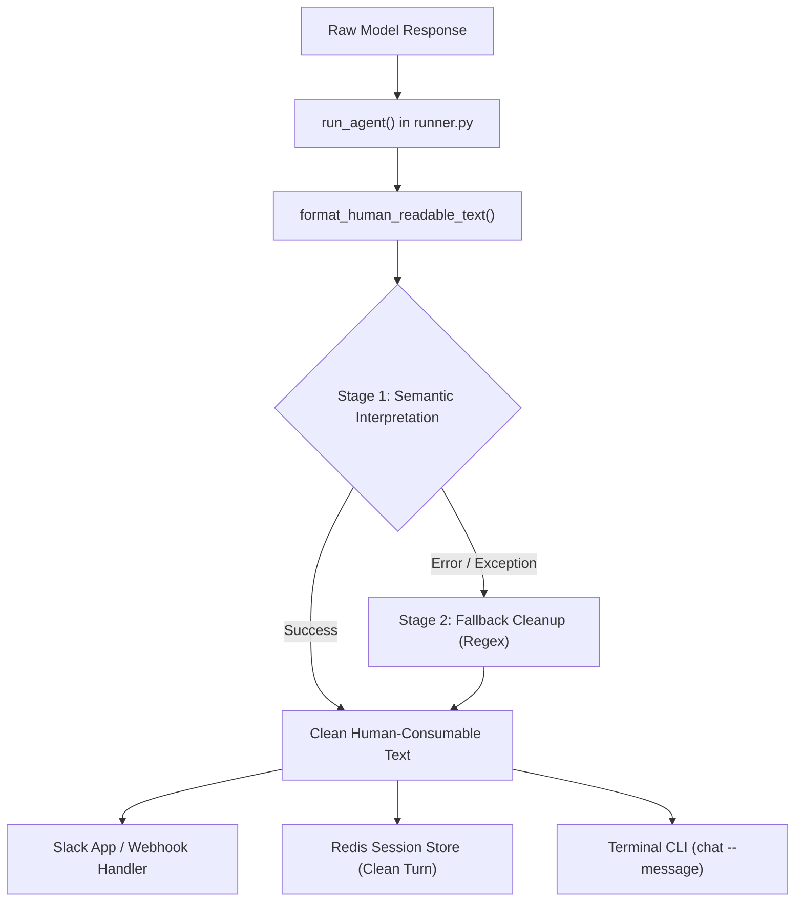

# Human-Consumable Response Formatting

Language models (such as Nebius Nemotron or Gemini) frequently emit responses wrapped in Markdown syntax—such as `**bold headings**`, glued numbers, and sentences run together without blank lines. When rendered in messaging interfaces like Slack, GitHub Markdown syntax like `**` renders as raw double asterisks instead of clean bold text, and glued headings appear as dense, unreadable walls of text.

Aryhant includes a dedicated formatting pipeline in `src/chat_agent/utils/text_formatter.py` that semantically **interprets** Markdown into spacious, clean, human-consumable text with automatic fallback cleanup.

---

## The Problem: Glued Model Output

In certain generation conditions, raw model outputs appear with glued markdown markers and run-on sentences:

```text
Here is a simple way to understand why the sky looks blue:**1. Sunlight is made of many colors**Even though sunlight looks white, it is actually a mix of all the colors of the rainbow — red, orange, yellow, green, blue, indigo, and violet.**2. Earth has an atmosphere**The air around us is filled with tiny gas molecules, dust, and water droplets... So the next time you see a blue sky, you are seeing sunlight playing hide-and-seek with air molecules! :mostly_sunny:Would you like me to explain anything else about weather, rainbows, or space?
```

### Visual Artifacts in Raw Output:
1. **Glued Numbered Headings**: `blue:**1. Sunlight...**Even though` has no line breaks before or after the heading.
2. **Raw Asterisks**: Slack mrkdwn does not interpret `**bold**`; it displays the literal `**` characters.
3. **Glued Sentence Boundaries**: Terminal punctuation attached directly to capital letters (`!So the Sun`).
4. **Glued Emojis and Closing Prompts**: `:mostly_sunny:Would you like...` run together without separation.

---

## Architectural Workflow

The formatting engine uses a two-stage parsing strategy: **Semantic Interpretation** first, followed by an automatic **Resilient Fallback Cleanup** if parsing encounters malformed syntax.



---

## Transformation Rules

### 1. Numbered Headings & Callouts
Interprets `**1. Title**Body` as a numbered section item, and `**Fun fact:**` as a callout header:
- `text:**1. Heading**Content` $\rightarrow$ `text:\n\n1. Heading\nContent`
- `text.**Bonus: Why...**Content` $\rightarrow$ `text.\n\nBonus: Why...\nContent`

### 2. Sentence Boundaries
Separates terminal punctuation glued to the next sentence while protecting decimals (e.g. `3.14`) and standard abbreviations (`e.g.`, `i.e.`, `Dr.`, `vs.`):
- `scatter the light!So the Sun` $\rightarrow$ `scatter the light!\n\nSo the Sun`

### 3. Emoji Preservation & Follow-up Questions
Slack shortcode emojis (`:mostly_sunny:`, `:sparkles:`) and Unicode emojis (🌞, 🌟) are strictly preserved, while un-gluing attached text:
- `:mostly_sunny:Would you like...` $\rightarrow$ `:mostly_sunny:\n\nWould you like...`

### 4. Markdown Removal
- Strips `**` and `__` markers.
- Converts markdown lists (`- `, `* `) into clean bullet points (`• `).
- Formats links `[Label](url)` into readable `Label (url)`.
- Replaces backtick code `` `code` `` with clean quotes `'code'`.

---

## Output Comparison

````carousel
```text
[BEFORE: Raw Model Output]
Here is the simple answer: **The Sun is actually white, but it looks yellow to us from Earth.**Here is why:**1. The Sun sends out all colors of light**The Sun shines with every color of the rainbow mixed together. When all those colors combine, they make white light.**2. Earth’s atmosphere acts like a filter**Before sunlight reaches your eyes, it passes through the air around Earth. Tiny molecules in the air scatter (bounce around) the blue and violet light more than the other colors.**Fun fact:** Astronauts in space see the Sun as pure white because there is no atmosphere to scatter the light!So the Sun is not really yellow — it just looks that way because of our atmosphere. :mostly_sunny:Would you like to know more about stars, rainbows, or how light travels?
```
<!-- slide -->
```text
[AFTER: Human-Consumable Output]
Here is the simple answer: The Sun is actually white, but it looks yellow to us from Earth.

Here is why:

1. The Sun sends out all colors of light
The Sun shines with every color of the rainbow mixed together. When all those colors combine, they make white light.

2. Earth’s atmosphere acts like a filter
Before sunlight reaches your eyes, it passes through the air around Earth. Tiny molecules in the air scatter (bounce around) the blue and violet light more than the other colors.

Fun fact:
Astronauts in space see the Sun as pure white because there is no atmosphere to scatter the light!

So the Sun is not really yellow — it just looks that way because of our atmosphere. :mostly_sunny:

Would you like to know more about stars, rainbows, or how light travels?
```
````

---

## Programmatic Usage

```python
from chat_agent.utils.text_formatter import format_human_readable_text

raw_llm_response = "Here is why:**1. First Point**Details here."
clean_response = format_human_readable_text(raw_llm_response)
print(clean_response)
```

The function is integrated directly into:
- [`src/chat_agent/agents/runner.py`](file:///C:/codebase/Aryhant/src/chat_agent/agents/runner.py) at the completion of `run_agent()`.
- [`src/chat_agent/slack/post_generator.py`](file:///C:/codebase/Aryhant/src/chat_agent/slack/post_generator.py) for structured Block Kit formatting.
