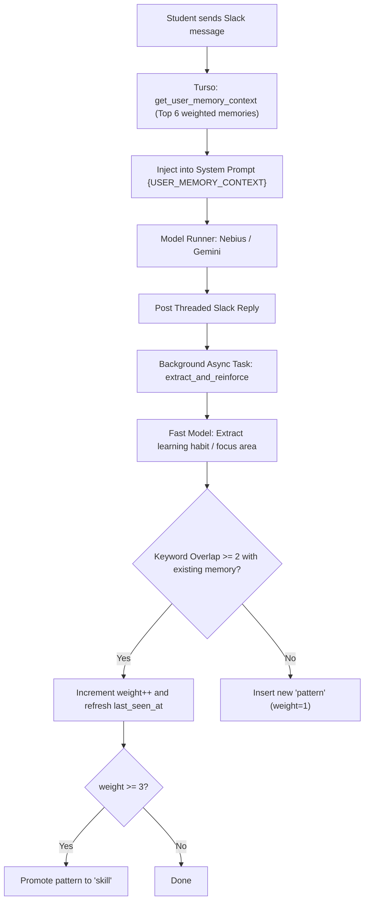

# Turso memory and preferences

Aryhant includes a persistent personal memory and preferences engine backed by **Turso (libSQL)**. This transforms the bot from a stateless chatbot into an authentic, adaptive educational companion that remembers student learning styles, recurring arithmetic focus areas, explanation language preferences, and mastered skills across sessions.

The engine lives in `src/chat_agent/services/turso_memory_service.py` and pairs with an interactive Slack modal in `src/chat_agent/slack/preferences_modal.py`.

## Two-Tier Memory Architecture

Aryhant divides state into two complementary tiers:

| Tier | Storage Engine | Scope | Lifecycle | Purpose |
| :--- | :--- | :--- | :--- | :--- |
| **Tier 1: Thread History** | **Upstash Redis** | Per Slack Thread (`session_id`) | 24 Hours (`REDIS_TTL_SEC`) | Multi-turn conversation context, recent back-and-forth turns |
| **Tier 2: Personal Memory** | **Remote Turso (libSQL)** | Per Student (`slack:user_id`) | Permanent / Long-term | Verified study preferences, recurring focus topics, mastered skills |

## Architectural Workflow



## SQL Schema & Data Model

Turso stores data across two relational tables with composite indexing:

```sql
CREATE TABLE IF NOT EXISTS user_profiles (
    user_id TEXT PRIMARY KEY,
    display_name TEXT NOT NULL,
    real_name TEXT NOT NULL,
    email TEXT,
    created_at INTEGER NOT NULL,
    updated_at INTEGER NOT NULL
);

CREATE TABLE IF NOT EXISTS memories (
    id TEXT PRIMARY KEY,
    user_id TEXT NOT NULL,
    kind TEXT NOT NULL CHECK(kind IN ('preference', 'fact', 'pattern', 'skill')),
    text TEXT NOT NULL,
    keywords TEXT NOT NULL,                      -- JSON array of strings: '["lcm", "hcf", "fractions"]'
    weight INTEGER NOT NULL DEFAULT 1,
    source TEXT NOT NULL CHECK(source IN ('request', 'interest', 'wake', 'manual')),
    category TEXT,                               -- e.g., 'Mathematics', 'Science', 'Language', 'Tone'
    request_id TEXT,
    created_at INTEGER NOT NULL,
    updated_at INTEGER NOT NULL,
    last_seen_at INTEGER NOT NULL,
    FOREIGN KEY(user_id) REFERENCES user_profiles(user_id) ON DELETE CASCADE
);

CREATE INDEX IF NOT EXISTS idx_memories_user ON memories(user_id);
CREATE INDEX IF NOT EXISTS idx_memories_user_kind ON memories(user_id, kind);
CREATE INDEX IF NOT EXISTS idx_memories_user_weight ON memories(user_id, weight DESC, last_seen_at DESC);
```

### Privacy & Data Invariants

- **Zero PII in Memory Text**: The `text` field in `memories` strictly stores prompt-ready pedagogical principles (e.g., *"Prefers step-by-step arithmetic hints before seeing final answers"*). It **never** stores raw student messages, phone numbers, addresses, or private details.
- **Tenant Isolation**: Every query filters strictly on `user_id = 'slack:U...'`. A student's memories are completely isolated from other users.

## Multi-Script Keyword Tokenization

To support multilingual ICSE students (English, Hindi, and Bengali) without heavy external NLP dependencies, the engine implements a regex-based Unicode multi-script tokenizer:

```python
MULTI_SCRIPT_TOKEN_RE = re.compile(r"[\w\u0900-\u097F\u0980-\u09FF]+", re.UNICODE)
```

- Normalizes text and extracts tokens with $\ge 3$ characters.
- Filters domain-specific stopwords (`the`, `please`, `explain`, `questions`).
- Extracts Sanskrit/Hindi Devanagari (`\u0900-\u097F`) and Bengali (`\u0980-\u09FF`) scripts natively.

## Autonomous Reinforcement & Skill Promotion

1. **Initial Observation**: A new habit or focus topic is recorded as a `pattern` with `weight = 1`.
2. **Deduplication via Overlap**: When a student asks a related question in subsequent sessions, the tokenizer checks keyword overlap with existing memories. If $\ge 2$ keywords overlap, `weight` is incremented (`weight++`) instead of creating redundant rows.
3. **Skill Promotion (`weight >= 3`)**: When a pattern reaches `weight >= 3`, the engine automatically elevates its `kind` to `'skill'`. In the Slack modal and prompt context, it is badged as a **Mastered Topic / Learned Skill**.

## Interactive Slack Management (`/preferences`)

Students and teachers have complete transparency and data sovereignty over what Aryhant remembers:

- **Slash Command**: Typing `/preferences` in Slack triggers an ephemeral `views_open` call opening a private Block Kit popup modal.
- **Learned Skills Badges**: Displays high-confidence mastered topics at the top.
- **Interactive Deletion**: Each preference has an individual `Delete` button accessory (`action_id="delete_memory_action"`). Clicking it deletes the record from Turso and immediately refreshes the modal in real time via `client.views_update`.
- **Clear All Preferences**: A danger-styled button with a confirmation popup allowing users to exercise their right to be forgotten.

## Manual Testing in Slack

You can verify and test student preferences end-to-end directly in Slack via the interactive modal or natural conversational distillation.

### Method 1: The Interactive `/preferences` Modal

1. **Prerequisite (Slack Slash Command Registration)**:
   - Navigate to [api.slack.com/apps](https://api.slack.com/apps) $\rightarrow$ Your App $\rightarrow$ **Slash Commands**.
   - Ensure `/preferences` is configured:
     - **Command**: `/preferences`
     - **Short Description**: `View and manage personal learning preferences`
     - **Usage Hint**: `(opens modal)`
2. **Open the Modal**:
   - In Slack, type `/preferences` in any direct message or channel with the bot and press Enter.
   - A private Block Kit modal opens displaying:
     - 🏆 **Learned Skills & Mastered Topics**: Badged competencies that reached confidence weight $\ge 3$.
     - 📌 **Active Preferences & Habits**: List of individual habits with per-item **Delete** buttons.
     - 🗑️ **Clear All Memories**: Dangerous action with confirmation dialog to purge all records.
3. **Test Deletion & Clear**:
   - Click **Delete** next to any preference item or click **Clear All Memories**.
   - The modal automatically refreshes in real time via `client.views_update` without posting to the channel.

### Method 2: Natural Language Distillation & Reinforcement

1. **Teach a Habit via Direct Message**:
   Send a message expressing an explicit pedagogical style or habit:
   > *"I learn best when you provide step-by-step hints and analogies before giving the final answer."*
2. **Observe Terminal Logs**:
   In your terminal running `python -m chat_agent.main slack`, the background distiller extracts and records the habit without adding latency to the student's Slack response:
   ```text
   INFO | turso_memory_service.extract_and_reinforce | Successfully extracted and recorded memory pattern for slack:U...: 'Prefers step-by-step hints and analogies' (category=Tone)
   ```
3. **Verify Context Injection in Subsequent Turns**:
   In a new message, ask an academic question:
   > *"How do I find the area of a triangle?"*
   - Observe in the terminal logs that `user_memory_context` is retrieved and injected into the prompt:
     ```text
     INFO | turso_memory_service.get_user_memory_context | Fetching user memory context for slack:U...
     ```
   - Aryhant's reply will structure the explanation with guiding hints and analogies according to your stored preference before providing final values.
4. **Confirm in Modal**:
   Type `/preferences` again to see your newly distilled preference listed under **Active Preferences & Habits**.

## Database Migrations

The database tables and indexes are initialized using an explicit migration script:

```bash
python scripts/init_turso_db.py
```

- If `ARYHANT_TURSO_DATABASE_URL` and `ARYHANT_TURSO_AUTH_TOKEN` are set, it connects to remote Turso (`aryhant`) via `libsql` with the local embedded replica (`aryhant.db`) and synchronizes the schema. If `libsql` is missing, the service and migration script fail loud with a `RuntimeError` rather than silently misconfiguring. Runtime network blips gracefully degrade to the local replica and default empty context to ensure uninterrupted student chat service.
- On serverless platforms such as Google Cloud Run, continuous background timer threads (`sync_interval`) are avoided. Instead, all write operations execute an explicit pre-write sync (`conn.sync()`) to pull the latest remote changes into the local embedded replica before transaction write locking, followed by an immediate post-write sync after commit.
- If unconfigured, it seamlessly initializes the local embedded replica database (`aryhant.db`, resolved via `settings.resolved_turso_db_path`) for local testing.
