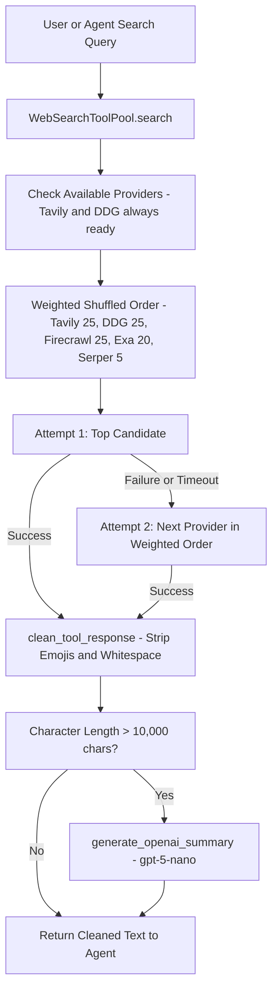

# Web search

The agent is equipped with the `search_web` tool directly configured in the execution engine in `src/chat_agent/agents/gemini_model_runner.py` and `src/chat_agent/agents/nebius_model_runner.py` alongside `get_current_time`, `generate_study_notes_pdf`, and `generate_infographic_pdf`. The underlying implementation in `src/chat_agent/tools/tool_factory.py` manages a multi-provider search pool with weighted selection, automatic provider failover, response sanitization, and automatic summarization.

## Tool Integration

```python
# src/chat_agent/agents/gemini_model_runner.py
_TOOLS = [
    get_current_time,
    search_web,
    generate_study_notes_pdf,
    generate_infographic_pdf,
]
_TOOL_MAP = {fn.__name__: fn for fn in _TOOLS}
```

The system prompt instructs the agent to use `search_web` when researching up-to-date facts, current events, technical references, or ICSE curriculum guidelines.

## Supported Providers

| Provider | Environment Variable | Default Weight | Features & Fallback Mechanism |
| :--- | :--- | :--- | :--- |
| **DuckDuckGo** | *None required* | `25.0` | Modular engine in `duckduckgo_search.py`; uses `ddgs` library with challenge detection, `uddg` redirect unwrapping, and block-scoped HTML fallback |
| **Tavily** | *None required* (`TAVILY_API_KEY` optional) | `25.0` | Two-part execution: keyless-first REST (`X-Tavily-Access-Mode: keyless`), falls back to `TavilyClient`, with structured extraction via `/extract` |
| **Exa** | `EXA_API_KEY` | `20.0` | Semantic web search via `https://api.exa.ai/search` |
| **Firecrawl** | `FIRECRAWL_API_KEY` | `25.0` | Structured markdown web search via `https://api.firecrawl.dev/v1/search` |
| **Serper** | `SERPER_API_KEY` | `5.0` | Google Search API proxy via `https://google.serper.dev/search` |

## Keyless-First Tavily Search & Extract

Tavily provides free keyless access out of the box with zero configuration:
- **Two-Part Search Contract**:
  1. **Part 1 (Keyless)**: `TavilySearchTool.search()` first attempts unauthenticated query execution using the `X-Tavily-Access-Mode: keyless` header against `https://api.tavily.com/search`.
  2. **Part 2 (TavilyClient Fallback)**: If keyless search fails and `TAVILY_API_KEY` is present, it retries via `TavilyClient(api_key=self.api_key)`.
  3. **Clean Exit**: If `TavilyClient` fails or no key is provided, the tool terminates retries immediately and returns `answer="tavily failed try with some other websearch"`, triggering seamless failover in `WebSearchToolPool`.
- **Structured Extraction**: `TavilySearchTool.extract()` and `extract_web_content()` pull structured markdown and text from specific web URLs via `https://api.tavily.com/extract`, using the same keyless-first, API-key fallback strategy.

## Modular DuckDuckGo Search Engine

The DuckDuckGo implementation is decoupled into `src/chat_agent/tools/duckduckgo_search.py`, providing a resilient zero-config search engine:

1. **Modern `ddgs` Integration**: Executes `ddgs.DDGS().text(query=query, max_results=max_results)` via context manager with support for fallback between `ddgs` and `duckduckgo_search`.
2. **Bot-Challenge Detection**: `is_ddg_challenge_page()` inspects response HTML for HTTP 200 bot challenge / rate-limit pages (`anomaly`, `cf-challenge`, `challenge-platform`, `too many requests`) so `WebSearchToolPool` fails over to other engines rather than silently returning empty results.
3. **`uddg` Redirect Unwrapping**: `extract_real_url()` parses DuckDuckGo's internal `//duckduckgo.com/l/?uddg=...` redirect parameters to recover clean destination URLs (`https://...`) while dropping `/y.js` ad trackers.
4. **Block-Segmented HTML Scraper**: `parse_ddg_html()` isolates HTML into per-result blocks (`class="...result..."`) before extracting fields, eliminating cross-result snippet drift when a search result lacks a snippet.
5. **Anti-Fingerprinting Headers**: Sends realistic `Referer: https://html.duckduckgo.com/`, `Accept-Language`, and `User-Agent` headers.

## Weighted Selection and Automatic Failover

When `DEFAULT_SEARCH_PROVIDER` is set to `random` (default) or `auto`:
1. The pool identifies all configured providers (Tavily and DuckDuckGo are always available without keys, plus any other providers with non-empty API keys).
2. It executes a **weighted sampling without replacement** based on configured provider weights.
3. If the first selected provider fails (e.g., rate limit, network timeout), the pool immediately falls back to the next candidate provider until a valid search response is returned.



## Response Cleaning & Summarization

1. **`clean_tool_response`**: Removes Unicode emojis, control characters, and excess whitespace to keep context tokens minimal and focused.
2. **`format_search_response`**: Formats search results into structured text blocks. If the aggregate context length exceeds 10,000 characters, it triggers `generate_openai_summary` (in `src/chat_agent/utils/openai_utility.py`) using `gpt-5-nano` to compress the context before handing it to the model.

## Programmatic Entry Points

```python
from chat_agent.tools.duckduckgo_search import search_duckduckgo
from chat_agent.tools.tool_factory import (
    search_web,
    extract_web_content,
    get_search_pool,
    get_search_tool_usage_counts,
)

# 1. Execute search across weighted pool (keyless Tavily and DDG work out-of-the-box)
response = search_web(query="ICSE Class 5 Science living and non-living things", max_results=5)

# 2. Extract structured content from specific URLs via Tavily /extract
extracted = extract_web_content(urls=["https://en.wikipedia.org/wiki/FastAPI"])

# 3. Direct zero-config DuckDuckGo search via modular engine
ddg_results = search_duckduckgo(query="photosynthesis process Grade 5", max_results=5)

# 4. Inspect provider usage counts
counts = get_search_tool_usage_counts()
# Example output: {"duckduckgo": 14, "tavily": 16, "exa": 4, "firecrawl": 1, "serper": 0}
```
