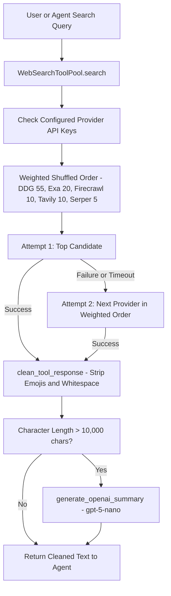

# Web search

The agent is equipped with the `search_web` tool directly configured in the execution engine in `src/chat_agent/agents/runner.py` alongside `get_current_time`, `generate_study_notes_pdf`, and `generate_infographic_pdf`. The underlying implementation in `src/chat_agent/tools/tool_factory.py` manages a multi-provider search pool with weighted selection, automatic provider failover, response sanitization, and automatic summarization.

## Tool Integration

```python
# src/chat_agent/agents/runner.py
_TOOLS = [
    get_current_time,
    search_web,
    generate_study_notes_pdf,
    generate_infographic_pdf,
]
_TOOL_MAP = {fn.__name__: fn for fn in _TOOLS}
```

The system prompt instructs the agent to use `search_web` when researching up-to-date facts, current events, technical references, or ICSE curriculum guidelines.

## Supported Providers

| Provider | Environment Variable | Default Weight | Features & Fallback Mechanism |
| :--- | :--- | :--- | :--- |
| **DuckDuckGo** | *None required* | `55.0` | Uses `ddgs` or `duckduckgo-search` package; falls back to BeautifulSoup / regex HTML scraping |
| **Exa** | `EXA_API_KEY` | `20.0` | Semantic web search via `https://api.exa.ai/search` |
| **Firecrawl** | `FIRECRAWL_API_KEY` | `10.0` | Structured markdown web search via `https://api.firecrawl.dev/v1/search` |
| **Tavily** | `TAVILY_API_KEY` | `10.0` | Agentic search with direct answers via Tavily SDK & REST fallback |
| **Serper** | `SERPER_API_KEY` | `5.0` | Google Search API proxy via `https://google.serper.dev/search` |

## Weighted Selection and Automatic Failover

When `DEFAULT_SEARCH_PROVIDER` is set to `random` (default) or `auto`:
1. The pool identifies all configured providers (those with non-empty API keys, plus DuckDuckGo).
2. It executes a **weighted sampling without replacement** based on configured provider weights.
3. If the first selected provider fails (e.g., rate limit, network timeout), the pool immediately falls back to the next candidate provider until a valid search response is returned.



## Response Cleaning & Summarization

1. **`clean_tool_response`**: Removes Unicode emojis, control characters, and excess whitespace to keep context tokens minimal and focused.
2. **`format_search_response`**: Formats search results into structured text blocks. If the aggregate context length exceeds 10,000 characters, it triggers `generate_openai_summary` (in `src/chat_agent/utils/openai_utility.py`) using `gpt-5-nano` to compress the context before handing it to the model.

## Programmatic Entry Points

```python
from chat_agent.tools.tool_factory import (
    search_web,
    get_search_pool,
    get_search_tool_usage_counts,
)

# 1. Execute search across weighted pool
response = search_web(query="ICSE Class 5 Science living and non-living things", max_results=5)

# 2. Inspect provider usage counts
counts = get_search_tool_usage_counts()
# Example output: {"duckduckgo": 14, "tavily": 2, "exa": 4, "firecrawl": 1, "serper": 0}
```
