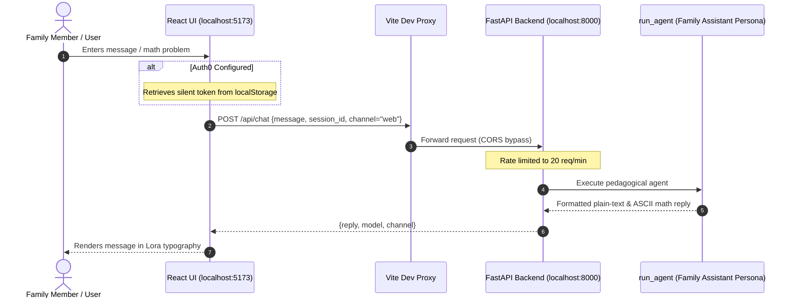

# Web UI

The `/ui` directory houses a modern React 18 + TypeScript single-page application (SPA) providing a direct web interface for Aryhant. It serves as an interactive Family AI Assistant for learning guidance, practice questions, research workflows, and family productivity.

The web app is optimized for static deployment to **Cloudflare Pages** and includes a zero-config development proxy for local backend connectivity.

---

## Architecture & Data Flow

The frontend connects to the FastAPI backend at `/api/chat` and `/api/health`. During local development, Vite proxies API requests directly to the local Uvicorn instance to eliminate CORS configuration overhead.



---

## Key Features

### 1. Family AI Assistant
- **Structured Explanations**: Answers formatted specifically for clear comprehension across educational and family tasks.
- **ASCII & Plain-Text Math**: Renders math using clean fractions (`3/5`), superscripts (`cm²`), and arithmetic operators without raw LaTeX clutter.
- **Session Continuity**: Retains conversation history across page reloads by generating a unique session key persisted in `sessionStorage`.

### 2. Typography & Visual Identity
- **Font**: Styled with Google Font **Lora** for a classic, notebook-like reading experience.
- **Header Avatar**: Displays the official character artwork from `Aryhant.jpg`.
- **Tab Favicon**: Custom browser tab icon using `icon.ico`.

### 3. Pure Auth0 Universal Login / PKCE
- Powered by `@auth0/auth0-react`.
- Uses `useRefreshTokens={true}` and `cacheLocation="localstorage"` to eliminate third-party cookie restrictions in modern browsers on `localhost`.
- When Auth0 environment variables are omitted, the application runs automatically in open / demo mode.

### 4. WebMCP Agent Bridge & In-Browser Retrieval
- **3-Tier WebMCP Standard**: Publishes tools to Chrome `document.modelContext`, declarative DOM forms, and JSON-RPC `postMessage` listeners.
- **Client-Side Document Parsing**: Ingests files under 2MB (`.pdf`, `.docx`, `.doc`, `.txt`, `.md`) via `@llamaindex/liteparse-wasm` and builds an in-memory BM25 index persisted in browser IndexedDB (`AryhantDB`).
- **Reference URLs Manager**: Stores up to 10 verified syllabus/reference URLs accessible to visiting agents via `get_reference_url`.
- See the dedicated [WebMCP Browser Integration](/webmcp) guide for tool signatures and discovery protocols.

### 5. Rate Limit & Safety Alerts
- Aligned with the backend's **20 requests/minute** limit (`Rate(20, Duration.MINUTE)`).
- When the rate limit is reached, an alert banner displays a countdown message rather than failing silently.

---

## Directory Structure

<Tree>
  <Tree.Folder name="ui" defaultOpen>
    <Tree.Folder name="public" defaultOpen>
      <Tree.File name="Aryhant.jpg" />
      <Tree.File name="icon.ico" />
      <Tree.File name="liteparse_wasm_bg.wasm" highlight />
    </Tree.Folder>
    <Tree.Folder name="src" defaultOpen>
      <Tree.Folder name="components" defaultOpen>
        <Tree.File name="ChatPanel.tsx" highlight />
        <Tree.File name="FileUpload.tsx" highlight />
        <Tree.File name="Header.tsx" />
        <Tree.File name="MessageInput.tsx" />
        <Tree.File name="MessageItem.tsx" />
        <Tree.File name="MessageList.tsx" />
        <Tree.File name="ReferenceUrls.tsx" highlight />
        <Tree.File name="StatusPill.tsx" />
      </Tree.Folder>
      <Tree.Folder name="hooks" defaultOpen>
        <Tree.File name="useDocumentController.ts" highlight />
      </Tree.Folder>
      <Tree.Folder name="lib" defaultOpen>
        <Tree.File name="api.ts" />
        <Tree.File name="bm25.ts" highlight />
        <Tree.File name="config.ts" />
        <Tree.File name="ddgSearch.ts" highlight />
        <Tree.File name="idbStorage.ts" highlight />
        <Tree.File name="liteparseService.ts" highlight />
        <Tree.File name="mathEvaluator.ts" highlight />
        <Tree.File name="searchService.ts" highlight />
        <Tree.File name="tavilySearch.ts" highlight />
        <Tree.File name="types.ts" />
      </Tree.Folder>
      <Tree.Folder name="webmcp" defaultOpen>
        <Tree.File name="agentGuide.ts" highlight />
        <Tree.File name="provider.ts" highlight />
        <Tree.File name="tools.ts" highlight />
        <Tree.File name="types.ts" />
      </Tree.Folder>
      <Tree.File name="App.tsx" highlight />
      <Tree.File name="index.css" />
      <Tree.File name="main.tsx" />
      <Tree.File name="vite-env.d.ts" />
    </Tree.Folder>
    <Tree.File name="index.html" />
    <Tree.File name="package.json" />
    <Tree.File name="tsconfig.json" />
    <Tree.File name="vite.config.ts" highlight />
  </Tree.Folder>
</Tree>

---

## Local Development

### 1. Install Dependencies
```powershell
cd ui
npm.cmd install    # On Windows (or 'npm install' on Linux/macOS)
```

### 2. Environment Variables (Optional)
Configure Vite environment variables when integrating with Auth0 or targeting a remote backend:

| Variable | Description | Default |
| :--- | :--- | :--- |
| `VITE_AUTH0_DOMAIN` | Auth0 tenant domain (e.g. `dev-xxx.us.auth0.com`) | `""` (runs unauthenticated) |
| `VITE_AUTH0_CLIENT_ID` | Auth0 Single Page Application Client ID | `""` |
| `VITE_AUTH0_AUDIENCE` | API audience identifier matching backend `AUTH0_AUDIENCE` | `""` |
| `VITE_API_BASE_URL` | Remote FastAPI URL | `""` (uses local dev proxy `/api`) |

### 3. Run Development Servers

Start the FastAPI backend with Infisical secrets:
```powershell
infisical run -- python -m uvicorn chat_agent.app:app --host 127.0.0.1 --port 8000
```

Start the Vite frontend on `http://localhost:5173`:
```powershell
cd ui
infisical run -- npm run dev
# On Windows PowerShell:
infisical run -- npm.cmd run dev
```

---

## Cloudflare Pages Deployment

### 1. Build Static Bundle
```powershell
npm.cmd run build
```
This runs TypeScript validation and compiles static assets to `ui/dist/`.

### 2. Cloudflare Dashboard Settings
- **Framework Preset**: `Vite`
- **Root Directory**: `ui`
- **Build Command**: `npm run build`
- **Build Output Directory**: `dist`
- **Production Environment Variables**:
  - `VITE_API_BASE_URL`: `https://aryhant-xxxx-uc.a.run.app` (or your deployed backend URL)
  - `VITE_AUTH0_DOMAIN`: Your Auth0 domain
  - `VITE_AUTH0_CLIENT_ID`: Your Auth0 client ID
  - `VITE_AUTH0_AUDIENCE`: Your Auth0 API audience
