# WebMCP Browser Integration

Aryhant's web workspace (`/ui`) implements the open **WebMCP** protocol, turning the browser into a tool-equipped environment for visiting AI agents, Chrome extensions, and automated evaluators.

---

## The 3 WebMCP Compatibility Tiers

To ensure seamless discovery and execution across any browser, extension, or visiting AI runtime, the WebMCP bridge publishes its tool suite across three distinct interoperability models simultaneously:

```mermaid
graph TD
    subgraph Tier1 [1. Imperative JS API Surface]
        A1["document.modelContext (Chrome Native Flag)"]
        A2["navigator.modelContext & Testing"]
        A3["window.webmcp & window.modelContext Bridge"]
    end

    subgraph Tier2 [2. Declarative DOM Surface]
        B1["#webmcp-declarative-container (aria-hidden)"]
        B2["<form toolname='...' tooldescription='...'>"]
        B3["<input name='...' toolparamdescription='...'>"]
    end

    subgraph Tier3 [3. Isolated-World postMessage Bridge]
        C1["window.addEventListener('message')"]
        C2["JSON-RPC 2.0 (tools/list, tools/call)"]
        C3["Aliases (WEBMCP_GET_TOOLS, WEBMCP_EXECUTE_TOOL)"]
        C4["Custom Events (webmcp:ready, modelcontext:ready)"]
    end

    Agent1[Chrome Native WebMCP] --> Tier1
    Agent2[DOM Inspector Extensions] --> Tier2
    Agent3[Manifest V3 Isolated Content Scripts] --> Tier3

    Tier1 --> Core[WebMCP Core Provider & 9 Tools]
    Tier2 --> Core
    Tier3 --> Core
```

### Tier 1: Imperative JavaScript API
- **Official Chromium Surface (`document.modelContext`)**:
  - Automatically registers each tool with native `AbortController` signals when `chrome://flags/#enable-webmcp-testing` is enabled.
  - Installs a polyfill (`getTools`, `listTools`, `registerTool`, `executeTool`) when the experimental native flag is absent.
- **Draft & Testing Surfaces (`navigator.modelContext` & `navigator.modelContextTesting`)**:
  - Implements the draft specification properties for extensions targeting navigator-level bindings.
- **Global Window Bridge (`window.webmcp` & `window.modelContext`)**:
  - Provides a direct JavaScript object offering `listTools()`, `getTools()`, `callTool(name, args)`, and `executeTool(name, args)` for console inspection and script automation.

### Tier 2: Declarative DOM Representation
- Injects a hidden DOM container (`#webmcp-declarative-container`, `aria-hidden="true"`).
- Automatically synthesizes one `<form toolname="..." tooldescription="...">` per tool with inputs `<input name="..." toolparamdescription="...">` for every argument.
- Form `submit` event listeners allow DOM-crawling extensions and accessibility agents to invoke tools without direct JavaScript execution permissions.

### Tier 3: Isolated-World `postMessage` (JSON-RPC 2.0)
- Sandboxed extensions (such as Chrome Manifest V3 Content Scripts) cannot access page JavaScript objects directly due to isolated world security boundaries.
- A `window.addEventListener('message')` listener implements standard JSON-RPC 2.0:
  - Supports methods: `tools/list`, `tools/call`, `listTools`, `getTools`, `callTool`, `executeTool`.
  - Supports extension message types: `WEBMCP_GET_TOOLS`, `WEBMCP_EXECUTE_TOOL`, `MODEL_CONTEXT_CALL_TOOL`.
  - Replies via `event.source.postMessage` using standardized payloads `{ content: [{ type: 'text', text }] }` and JSON-RPC error codes (e.g. `-32603`).
- Dispatches window CustomEvents `webmcp:ready` and `modelcontext:ready` upon startup.

---

## Active Tool Suite (9 Tools)

| Tool Name | Parameters | Description |
| :--- | :--- | :--- |
| `get_tool_usage_prompt` | `{}` | Read-only: returns the official agent operating guide. Calling this first is recommended for visiting agents. |
| `get_reference_url` | `{}` | Read-only: returns comma-separated external reference and syllabus URLs configured by the user. |
| `get_current_time` | `{}` | Read-only: returns user's local date, weekday, time, timezone, and ISO timestamp. |
| `get_chat_history` | `{}` | Returns recent dialogue turns prefixed with `user:` and `agent:`. |
| `chat_post` | `{ text: string }` | Posts an assistant reply or status message directly into the chat stream. |
| `search_document` | `{ query: string }` | Client-side BM25 search over uploaded document chunks in browser IndexedDB. Returns top 3 relevant pages. |
| `clean_document` | `{}` | Purges stored document metadata, chunks, and BM25 index from IndexedDB. |
| `search_web` | `{ query: string }` | Live web search using keyless Tavily AI with automatic DuckDuckGo fallback. |
| `calculate` | `{ expression: string }` | Evaluates decimal and scientific mathematical expressions accurately. |

---

## Client-Side Ingestion & Browser Storage

### 1. Document Extraction (<2MB)
- Supported formats: `.pdf`, `.docx`, `.doc`, `.txt`, `.md`.
- Powered by `@llamaindex/liteparse-wasm` running directly in the browser via WebAssembly (`/liteparse_wasm_bg.wasm`), backed by an in-browser stream decompressor fallback for non-standard PDF encodings and PKZip extraction for Word documents.
- Strict client-side boundary: files never leave the browser.

### 2. IndexedDB Architecture (`AryhantDB`)
- **`documents`**: Metadata for the active uploaded document (`id`, `name`, `size`, `pageCount`, `createdAt`).
- **`chunks`**: Extracted per-page text chunks indexed by `docId`.
- **`bm25_index`**: Serialized BM25 inverted index with Robertson-Spärck Jones IDF weighting and stop-word filtering.
- Rehydrates automatically upon page reloads.

### 3. Reference URLs
- Users can manage up to 10 verified URLs via the sidebar manager.
- Reachability is validated in real-time with a 5-second probe before storing in `localStorage`.
- Visiting agents access these URLs via `get_reference_url` to ground answers in authoritative reference material.
